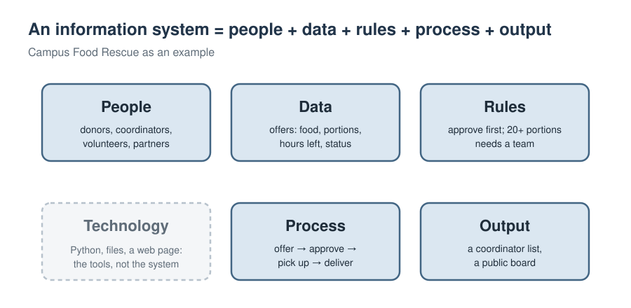

# Course guide

## Why learn programming when AI can write code?

AI tools now write code quickly, and they get better every year. Some of their code is good. Some of it **runs but is risky**: it hides a rule in a magic number, loses a record, shows private data, or accepts input that should be refused.

So what is left for people to do? My answer is **responsibility**. Think of AI as a fast developer on your team. It can suggest the code, and even the design. But it cannot take responsibility for what the system does to people. When a system shows a private phone number, loses a record or sends food that is no longer safe, someone must take responsibility. That someone is the person who decided to use the code, or who chose the rules and the approach: the systems developer, or the manager. In your work, that person will be you.

Responsibility needs understanding. You cannot approve code you cannot read, or defend a rule you cannot explain. That is why this course still teaches Python: not so you can type code faster than an AI, but so you know what you are accepting. You learn enough Python to:

1. **Think** like a systems designer: who uses the system, what data it keeps, which rules it follows.
2. **Code** the small pieces yourself, so you understand how they work.
3. **Judge** code, your own or an AI's, as *good* or *risky*, using ten design principles.

*Mengsay Loem, instructor*

## The system you build: Campus FoodBridge

Before any system exists, offers arrive by phone and are written in a paper notebook. On one busy morning, that notebook fails. The phone keeps ringing — Sunrise Bakery has bread rolls that must be collected within two hours, a canteen has cooked rice, a market stall has vegetables — and the coordinator writes each offer down as fast as she can. By the time the page is full, a phone number has been written twice, one offer squeezed into the margin is lost, and nobody can tell what was promised to whom.

The course replaces that notebook, one part per week. This is the system you build to replace it:

A fictional university volunteer team collects surplus food from **donors** (bakeries, canteens, market stalls) and delivers it to **community partners** (a children's centre, a community kitchen, an elders' group).

- A donor makes an **offer**: what food, how many **portions**, and how many **hours left** before it must be collected.
- The system **checks** the offer at the door and refuses bad input with a clear message.
- A **coordinator** (a person, not the program) approves or rejects it and chooses a partner.
- Volunteers **pick up** and **deliver** the food. Every change is kept in a **history**.
- The coordinator sees a full report; the public sees a board with no private data.

In Week 1 you run the finished system. From Week 2, you build one part of it each week. Each part has a **customisation point**: a decision only you can make, such as when a team is needed, which categories are allowed, or what the public can see. By Week 10, your system is different from everyone else's, and you can explain why.

## Ten principles: the course in one table

Each principle is a habit of a responsible developer. Together they help you check a system before you accept it.

| Week | Principle | In one sentence |
|---|---|---|
| 1 | **Clear names and units** | Code is read by people: a name should say what a value means and in what unit. |
| 2 | **Explicit rules** | Name your numbers, cover every case, and test the boundary. |
| 3 | **One record per real thing** | Each thing gets one record and one unique ID; do not store the same fact twice. |
| 4 | **One function, one job** | Return values instead of printing them; test normal, edge and odd cases. |
| 5 | **Never trust input** | Check at the door, explain problems in plain words, change nothing when input is bad. |
| 6 | **Make wrong states hard to reach** | Allow only the moves that make sense; keep the rule next to the data. |
| 7 | **Never lose data** | Save safely, keep a history, and be able to explain what happened. |
| 8 | **Right information for the right person** | Honest numbers; private data kept private. |
| 9 | **Separate what changes from what stays** | Keep decisions (settings, rules) apart from machinery (storage, screens). |
| 10 | **Verify before you trust** | Tests, clean runs and code review, especially for code written by AI. |

Every week has a **⚖️ Good or risky?** exercise: two versions of code that both run. You decide which is better and explain why, using that week's principle and naming who would be harmed.

## The ten weeks

Read this table as a journey that starts with the paper notebook. In Week 1 you meet the finished system that replaces it. From Week 2 you rebuild that system yourself, one part per week: first the rules the notebook left in people's heads, then one record for each real offer, then functions you can trust, checks at the door, safe lifecycles, saving and history, and reports for the right readers. Each week removes one way the notebook failed on that busy morning.

| Week | Topic | Python you learn | Part you build | Your decision |
|---|---|---|---|---|
| 1 | [What is an information system?](notebooks/Week_01.ipynb) | values, names, types, f-strings | an offer summary | the system's name |
| 2 | [Rules and decisions](notebooks/Week_02.ipynb) | comparisons, `if`/`elif`/`else`, a first function | `pickup_label`, `urgency` | team size, urgency hours |
| 3 | [Records and data](notebooks/Week_03.ipynb) | lists, dictionaries, `for` loops, totals | `total_portions`, `find_offer` | food categories |
| 4 | [Functions you can trust · Your first files · **Midterm**](notebooks/Week_04.ipynb) | `def`, `return`, docstrings, `assert` tests, creating `.py` files | `rules.py`, `records.py` (`open_portions`) | rule constants in `rules.py` |
| 5 | [Checking input](notebooks/Week_05.ipynb) | string methods, `int()`, exceptions, `try`/`except`, an error list, returning two values | `data_model.py`: `clean_offer` | limits and required fields |
| 6 | [Lifecycles](notebooks/Week_06.ipynb) | dict of lists, `in`, `.get()`, `while` loops, reading a class | `lifecycle.py`: `ALLOWED_MOVES`, `can_move` | whether approval is required |
| 7 | [Saving and history](notebooks/Week_07.ipynb) | memory and disk, files, `with`, JSON, JSON Lines, safe save | `storage.py`: save, load, history | what the history keeps |
| 8 | [Reports, screens and a first chart](notebooks/Week_08.ipynb) | `sorted` with a key, slices, counting into a dictionary, your first bar chart | `report.py` | what the public sees |
| 9 | [Assemble and analyse](notebooks/Week_09.ipynb) | `import`, functions calling functions, `if __name__ == "__main__"`, a menu loop; data for decisions | `app.py` (menu + browser screen) & your project charter | all settings |
| 10 | [Verify, hand over, present](notebooks/Week_10.ipynb) | `test_…()` in `tests.py`, clean runs, reading AI code | `tests.py`, your report, Demo day | — |

By Week 9 the parts work together as one system, with your own decisions in it. Week 10 closes the journey: you verify the system before you trust it, and you hand it over so that someone else can run the busy morning. The notebook's last weakness — that only the person who wrote it could use it — is gone.

## How a week works

Each week has three 90-minute sessions and one notebook. From Week 4 every week has the same shape:

| Part | What happens |
|---|---|
| **Class warm-up** | Share your research task in small groups (Weeks 2, 3 and 5–8). |
| **Session 1 · Understand** | One information-systems idea, then four or five Python concepts. Each one is **explained** (what it is, why it exists, how Python runs it, where you meet it in real apps), shown in a short **example** that you **predict** before you run, and practised in a **✍️ Try it**. From the second Try it, you write some of the test cases yourself. You finish with three **🔁 Explain it back** questions. |
| **Session 2 · Practise, then look under the hood** | First you practise: this week's ticket, model it on paper, a short ladder (puzzle → code). Then, together with the instructor, you look **under the hood**: how this week's file works and what happens if something changes, and **⚖️ Good or risky?** |
| **Session 3 · Build and decide** | Write this week's file in `my_foodbridge/`, check it (✅/❌), see your system (`bridge.show`), make **your decision** with evidence from data, and write three lines in your **📓 project journal**. |
| **Finish** | A checklist, **📚 Read more** (a Python Basics section and one chapter of a free book), the research task (if any) and a look at next week. |

Weeks 1–3 have a lighter version of this shape, with your code in notebook cells instead of files.

**The minimum is always reachable.** If you run every cell and complete the ⭐ tasks, you have a working part. ⭐⭐ tasks (at most two a week) are for going further with a little more thinking.

## Research tasks

Six short research tasks (5% each) take the course outside the notebook. In R1 and R2 you look at a real system you know. From Week 4, R3–R6 each teach you one programming concept before you need it, in four moves: **read** (a Python Basics section and one chapter of a free book), **ask** an AI about what stayed unclear, **check** one claim by running a tiny example, and **decide**: give your own view on a question that has no single right answer, such as *"Should a program crash, or keep going with a guess?"* See [research tasks](RESEARCH.md).

## Your final project

Your final project is your own `my_foodbridge/` folder, and it grows with you from Week 5:

- **Weeks 5–9:** each week ends with three lines in your 📓 project journal: what your system does now, one decision you made, one idea for your Final.
- **Week 8:** you choose one **extension** of your own, for example a new rule, a volunteer view or a weekly summary.
- **Week 9:** you write a half-page **project charter**: who uses your system, your three decisions so far, your extension and how you will test it, and a first drawing of your system.
- **Week 10:** you hand in your system and a short **report** (about two pages), then present it on **Demo day**: three minutes with your system poster, a live change, and one question.

See the [final project guide](FINAL_PROJECT.md).

## Using AI tools

You may use AI assistants to **explore and to ask questions**, except in the midterm and where a task says otherwise. In research tasks R3–R6 you read first, then ask an AI on purpose about what stayed unclear, and then you check what it said. Whatever you submit, you must be able to explain it: if you submit it, you are responsible for it, whoever wrote it. When an AI helps you, check at least one of its claims yourself and say how you checked. The course grades **understanding and judgement**, not the amount of code.
