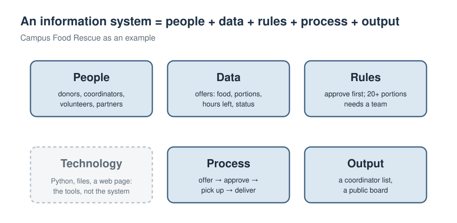

# Course guide

## Why learn programming when AI can write code?

AI tools now write code quickly, and they get better every year. Some of their code is good. Some of it **runs but is risky**: it hides a rule in a magic number, loses a record, shows private data, or accepts input that should be refused.

So what is left for people to do? My answer is **responsibility**. Think of AI as a fast developer on your team. It can suggest the code, and even the design. But it cannot take responsibility for what the system does to people. When a system shows a private phone number, loses a record or sends food that is no longer safe, someone must take responsibility. That someone is the person who decided to use the code, or who chose the rules and the approach: the systems developer, or the manager. In your work, that person will be you.

Responsibility needs understanding. You cannot approve code you cannot read, or defend a rule you cannot explain. That is why this course still teaches Python: not so you can type code faster than an AI, but so you know what you are accepting. You learn enough Python to:

1. **Think** like a systems designer: who uses the system, what data it keeps, which rules it follows.
2. **Code** the small pieces yourself, so you understand how they work.
3. **Judge** code, your own or an AI's, as *good* or *risky*, using ten design principles.

*Mengsay Loem, instructor*

## The system you build: Campus FoodBridge

A fictional university volunteer team collects surplus food from **donors** (bakeries, canteens, market stalls) and delivers it to **community partners** (a children's centre, a community kitchen, an elders' group).

- A donor makes an **offer**: what food, how many **portions**, and how many **hours left** before it must be collected.
- The system **checks** the offer at the door and refuses bad input with a clear message.
- A **coordinator** (a person, not the program) approves or rejects it and chooses a partner.
- Volunteers **pick up** and **deliver** the food. Every change is kept in a **history**.
- The coordinator sees a full report; the public sees a board with no private data.

In Week 1 you run the finished system. From Week 2, you build one part of it each week. Each part has a **customisation point**: a decision only you can make, such as when a team is needed, which categories are allowed, or what the public can see. By Week 10, your system is different from everyone else's, and you can explain why.

## Ten principles: the course in one table

Each principle is a habit of a responsible developer. Together they help you check a system before you accept it.

| Week | Principle | In one sentence |
|---|---|---|
| 1 | **Clear names and units** | Code is read by people: a name should say what a value means and in what unit. |
| 2 | **Explicit rules** | Name your numbers, cover every case, and test the boundary. |
| 3 | **One record per real thing** | Each thing gets one record and one unique ID; do not store the same fact twice. |
| 4 | **One function, one job** | Return values instead of printing them; test normal, boundary and odd cases. |
| 5 | **Never trust input** | Check at the door, explain problems in plain words, change nothing when input is bad. |
| 6 | **Make wrong states hard to reach** | Allow only the moves that make sense; keep the rule next to the data. |
| 7 | **Never lose data** | Save safely, keep a history, and be able to explain what happened. |
| 8 | **Right information for the right person** | Honest numbers; private data kept private. |
| 9 | **Separate what changes from what stays** | Keep decisions (settings, rules) apart from machinery (storage, screens). |
| 10 | **Verify before you trust** | Tests, clean runs and code review, especially for code written by AI. |

Every week has a **⚖️ Good or risky?** exercise: two versions of code that both run. You decide which is better and explain why, using that week's principle and naming who would be harmed.

## The ten weeks

| Week | Topic | Python you learn | Part you build | Your decision |
|---|---|---|---|---|
| 1 | What is an information system? | values, names, types, f-strings | an offer summary | the system's name |
| 2 | Rules and decisions | comparisons, `if`/`elif`/`else`, a first function | `pickup_label`, `urgency` | team size, urgency hours |
| 3 | Records and data | lists, dictionaries, `for` loops, totals | `total_portions`, `find_offer` | food categories |
| 4 | Functions you can trust · **Midterm** | `def`, `return`, docstrings, `assert` tests | `open_portions` + tests | which statuses count as open |
| 5 | Checking input | strings, `int()`, `try`/`except` | `clean_offer` | limits and required fields |
| 6 | Objects and lifecycles | classes, objects, methods | `can_move` | whether approval is required |
| 7 | Saving and history | files, `with`, JSON | `to_record`, `from_record` | what the history keeps |
| 8 | Reports and screens | sorting with a key, formatting, a menu | `public_row`, `handle_choice` | what the public sees |
| 9 | Putting the system together | modules, `import` | your whole system | every setting; optional web page |
| 10 | Verify, hand over, present | tests, clean runs, code review | the finished final project | — |

## How a week works

Each week has three 90-minute sessions and one notebook.

| Part | What happens |
|---|---|
| **Class warm-up** | Share your research task in small groups (Weeks 2, 3 and 5–8). |
| **Session 1 · Learn** | One information-systems idea, then the Python for it: explain, run, **predict**, check. |
| **Session 2 · Practise and judge** | Short exercises, then **⚖️ Good or risky?** |
| **Session 3 · Build** | Write this week's part, check it (✅/❌), plug it into the real system, and record **your decision**. |
| **Finish** | A checklist, the research task (if any) and a look at next week. |

**The minimum is always reachable.** If you run every cell and complete the ⭐ tasks, you have a working part. ⭐⭐ tasks are for going further with a little more thinking.

## Using AI tools

You may use AI assistants to **explore and to ask questions**, except in the midterm and where a task says otherwise. Whatever you submit, you must be able to explain it: if you submit it, you are responsible for it, whoever wrote it. When an AI helps you, check at least one of its claims yourself and say how you checked. The course grades **understanding and judgement**, not the amount of code.
