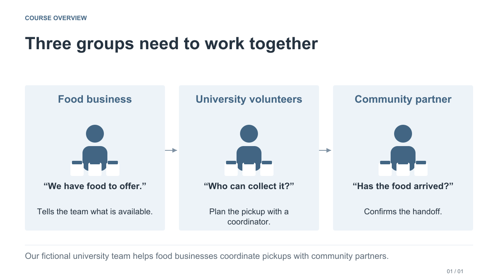
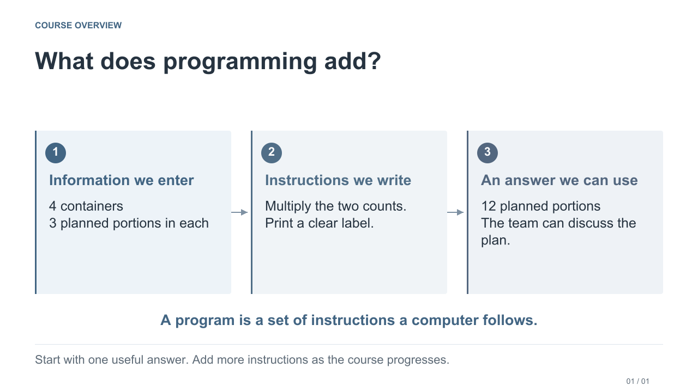
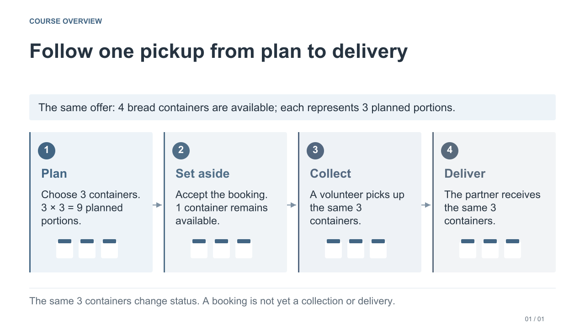
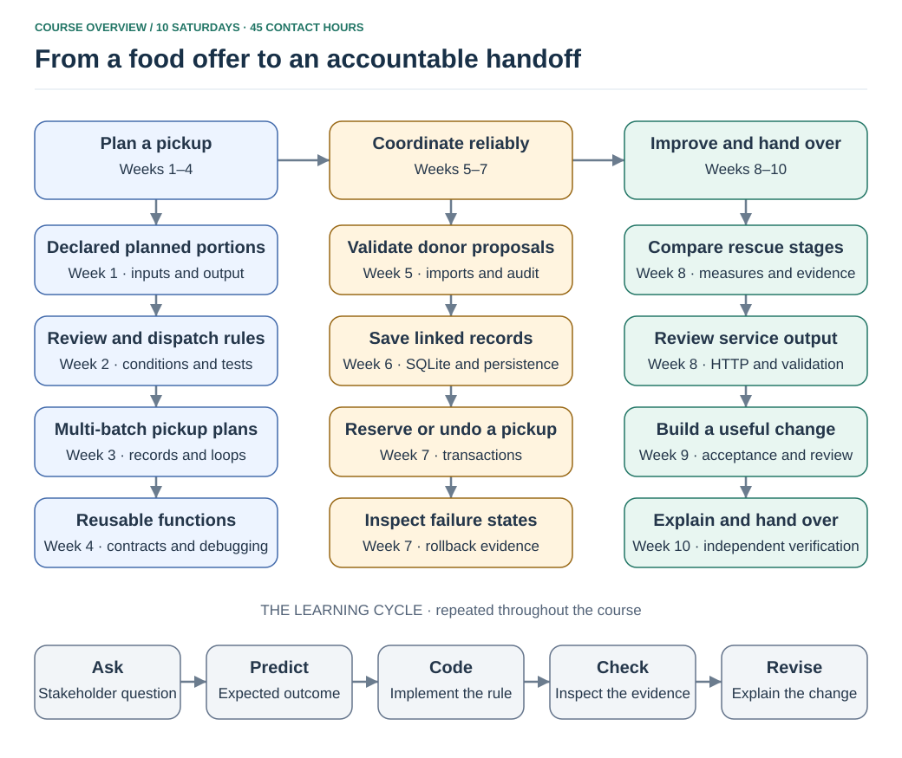

# Programming for Information Systems — Course overview

**Campus Food Rescue · Learn programming by helping a team plan pickups**

You can start with no programming experience. We will learn how to give a computer clear instructions, beginning with one calculation. Over ten weeks, those small programs help a fictional university volunteer team organize food pickups.

[Open the illustrated overview slides](/slides/Course_Overview.pdf)

## First, meet the people

A nearby food business has food to offer. University volunteers arrange a pickup with a human coordinator. A community partner receives the food. The team needs answers to three everyday questions: **What is available? Who will collect it? Has it arrived?**

Separate messages such as “four boxes” and “done” can be confusing. What is inside a box? Does “done” mean collected or delivered? An **information system** helps people keep agreed information and follow the same steps. The software is the part we will practice building.

## Start with one small program

A **program** is a set of instructions a computer follows. We give it information, tell it what to do, then check the answer.

Suppose a donor declares **3 planned portions in each container**, and we propose collecting **4 containers**. The calculation is `4 × 3 = 12 planned portions`. You will run a small Python example, change a value, predict the new result and explain what happened. You do not need to understand the whole final system to begin.

A **notebook** keeps the explanation, editable code and your observations together. Later, Python programs will also check agreed rules and save useful records. A **database** is where the program keeps organized information so it can find it again after closing.

## Follow the same pickup through four steps

Now change the proposed pickup to **3 of the same 4 bread containers**. With 3 declared planned portions each, the new plan represents **9 planned portions**. A **reservation** means an accepted booking: those 3 containers are set aside, leaving 1 available. A volunteer then collects them, and the partner receives them. The program records each step; it does not move the food.

These are the **same 3 containers** throughout. A plan is not yet a booking, and a booking does not prove collection or delivery. People confirm what actually happened. All organizations, quantities and approvals in the course are invented. The coordinator decides suitability and arrangements; a calculation does not certify food safety or count people served.

## What will you actually build?

In Weeks 1–8 you write and check small parts using supplied notebooks, programs and starting data. You calculate, choose a label, combine food lines, check incoming information, save plans and track pickups.

For the final project, we supply an integrated Python/SQLite starting application. In Weeks 9–10 you **improve one small feature**, check it and let a classmate run it using your instructions. For example, you might help a volunteer find pickups still awaiting collection. A browser dashboard is optional; the required work can run through notebooks and Python programs. You do not rebuild the entire application from an empty folder.

## See how the weeks fit together

The table keeps the full ten-week route visible. Python topic names are introduced in the relevant week; you do not need to know them now. Each week supplies its own starting files, so an unfinished earlier notebook does not prevent you from joining the next lesson.

| Week | Team's question | Programming and systems skills | Evidence |
|---|---|---|---|
| 1: A first plan | How many portions do these declared containers represent? | Notebook and `.py` execution, variables, types, arithmetic, strings and output | A labelled planning result and a question about an unclear unit |
| 2: Review and dispatch | Which requests need review, standard coordination or a team pickup? | Comparisons, Boolean logic, conditions and boundary cases | A decision table and checked outputs |
| 3: Multi-batch pickups | How do we combine several offer lines without losing their meaning? | Lists, dictionaries, loops and accumulators | Line/container/portion totals and a hand trace |
| 4: Functions and Midterm | Can you calculate, return, test and explain a result? | Functions, arguments, return values, loops, assertions and debugging | Canonical Midterm function, four tests and a reproducible ZIP |
| 5: Donor data | How do we validate rows and explain their outcomes? | Conversion and exception handling → CSV validation and audit; supplied duplicate grouping | Every source record has a justified disposition |
| 6: Saved plans | Can the next volunteer retrieve the same plan tomorrow? | Objects and methods; SQLite, identifiers, relationships, parameters and persistence | A saved plan with historical line facts |
| 7: Reliable reservations | What if availability runs out halfway through a pickup request? | Exceptions and with-blocks → transactions, guarded updates and failure-state checks | Complete success or unchanged state after failure |
| 8: Reports and intake | What was offered, reserved, collected and delivered—and what still needs review? | JSON values and dictionary checks → aggregation, HTTP validation and review queues | Stage evidence, six intake outcomes and a project proposal |
| 9: Your improvement | Which small change helps a volunteer or partner make a decision? | Functions, filters and assertions → acceptance cases, implementation and peer review | A working change and a justified revision |
| 10: Handoff | Can another volunteer run the system and explain its records? | Clean starts, commands, operating instructions and independent verification | A reproducible handoff and individual evidence |

## Your routine each week

| Session | What you do |
|---|---|
| 1 · Learn Python | Read a short explanation, trace examples and predict what they do. |
| 2 · Practise | Run, change and check examples in the same weekly notebook. |
| 3 · Project studio | Use the skill to help the volunteer team with one small task. |

The course has **10 weeks, three 90-minute sessions per week: 45 contact hours**. Week 4 reserves its final 135 minutes for the Midterm. Week 10 includes the operator demonstration in Session 2 and individual verification in Session 3. The weekly notebook and task PDF give the exact instructions and timing.

A useful learning cycle is **ask → predict → run or change → check → explain**. Save the required evidence and a backup, then stop; optional reference material can wait. Most weeks plan about 30–60 minutes of work outside class. See the [learning path](LEARNING_PATH.md) for the weekly expectations and exceptions.

## Find what you need

- [Course home](README.md): available weekly notebooks, PDFs and ZIPs.
- [Setup](SETUP.md): GitHub access, Colab or local Jupyter, and support files.
- [Python Basics](learning_materials/Python_Basics.ipynb): optional syntax lookup; required explanations and practice stay in the weekly notebook.
- [Assignment guides](assignments/README.md): programming and research tasks, examples and done checklists.
- [Assessment](ASSESSMENT.md) and [research guide](RESEARCH_ASSIGNMENTS.md): proposed weights, the Midterm, six short research assignments and the final project.
- [Question guide](CONTRIBUTING.md) and [course links](COURSE_LINKS.md): shared technical questions and the separately announced class routes.

The course home lists the weeks included in your package or website edition. Use the private course route for completed assessed submissions, personal matters and attendance questions. Instructor notes and completed weekly model answers stay separate from the student package.
