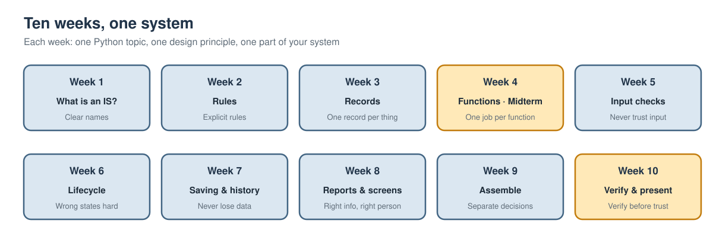

# Programming for Information Systems

**Campus Food Rescue · Mengsay Loem · English-language course for beginners**

AI can now write a lot of code. What it cannot do for you is decide what a system *should* do, or notice when code is risky. In this course you learn Python basics so you can **read code, test it and judge it**. Each week you build one part of a small information system and make **your own decisions** about it. By Week 10 you have your own working system.

**No programming background is needed.**

## Start here

1. **Set up once.** Read the [setup guide](SETUP.md). Google Colab works in the browser with nothing to install.
2. **Open your week.** Click **Open in Colab** in the table below, then **File → Save a copy in Drive** before you change anything.
3. **Run the setup cell**, then work through Sessions 1–3 and the Finish checklist.
4. **Look for ⭐ and ⭐⭐.** ⭐ is core work for everyone. ⭐⭐ is optional, for when you want to go further.

New here? Read the [course guide](COURSE_GUIDE.md) first: it explains the idea of the course, the system you will build and the ten design principles.

## Weekly materials

| Week | Principle | Read | Slides | Run | Download |
|---|---|---|---|---|---|
| **1** · What is an information system? | Clear names and units | [Notebook](notebooks/Week_01.ipynb) | [PDF](/slides/Week_01_Slides.pdf) |  | [.ipynb](/downloads/Week_01.ipynb) |
| **2** · Rules and decisions | Explicit rules | [Notebook](notebooks/Week_02.ipynb) | [PDF](/slides/Week_02_Slides.pdf) |  | [.ipynb](/downloads/Week_02.ipynb) |
| **3** · Records and data | One record per real thing | [Notebook](notebooks/Week_03.ipynb) | [PDF](/slides/Week_03_Slides.pdf) |  | [.ipynb](/downloads/Week_03.ipynb) |
| **4** · Functions you can trust · Midterm | One function, one job | [Notebook](notebooks/Week_04.ipynb) | [PDF](/slides/Week_04_Slides.pdf) |  | [.ipynb](/downloads/Week_04.ipynb) |
| **5** · Checking input | Never trust input | [Notebook](notebooks/Week_05.ipynb) | [PDF](/slides/Week_05_Slides.pdf) |  | [.ipynb](/downloads/Week_05.ipynb) |
| **6** · Objects and lifecycles | Make wrong states hard to reach | [Notebook](notebooks/Week_06.ipynb) | [PDF](/slides/Week_06_Slides.pdf) |  | [.ipynb](/downloads/Week_06.ipynb) |
| **7** · Saving and history | Never lose data | [Notebook](notebooks/Week_07.ipynb) | [PDF](/slides/Week_07_Slides.pdf) |  | [.ipynb](/downloads/Week_07.ipynb) |
| **8** · Reports and screens | Right information for the right person | [Notebook](notebooks/Week_08.ipynb) | [PDF](/slides/Week_08_Slides.pdf) |  | [.ipynb](/downloads/Week_08.ipynb) |
| **9** · Putting the system together | Separate what changes from what stays | [Notebook](notebooks/Week_09.ipynb) | [PDF](/slides/Week_09_Slides.pdf) |  | [.ipynb](/downloads/Week_09.ipynb) |
| **10** · Verify, hand over, present | Verify before you trust | [Notebook](notebooks/Week_10.ipynb) | [PDF](/slides/Week_10_Slides.pdf) |  | [.ipynb](/downloads/Week_10.ipynb) |

**Before you edit a notebook in Colab: File → Save a copy in Drive.** Every notebook unpacks the course system itself; nothing to upload. The [Food Rescue kit ZIP](/downloads/food_rescue_kit.zip) is the complete system for running at home.

## Midterm, final project and reference

| | When | Read | Slides | Run |
|---|---|---|---|---|
| **Midterm · Plan the day** | Week 4, Session 3 | [Notebook](notebooks/Midterm.ipynb) | [PDF](/slides/Midterm_Brief.pdf) |  |
| **Final project · Your Food Rescue system** | Weeks 9–10 | [Notebook](notebooks/Final_Project.ipynb) | [PDF](/slides/Final_Project_Brief.pdf) |  |
| **Python Basics · Quick lookup (optional)** | any week | [Notebook](notebooks/Python_Basics.ipynb) | — |  |
| **Orientation** (first class) | Week 1 | [Course guide](COURSE_GUIDE.md) | [PDF](/slides/Orientation.pdf) | — |

## Course information

- [Course guide](COURSE_GUIDE.md): why this course, the ten principles, how a week works
- [Setup](SETUP.md): Colab or your own computer
- [Assessment](ASSESSMENT.md): how you are graded, and the rules for AI tools
- [Research tasks](RESEARCH.md): the six short research tasks and when they are shared
- [Final project](FINAL_PROJECT.md): the four levels, from "run it" to "web page"
- [Instructor](INSTRUCTOR.md) · [Course links](COURSE_LINKS.md) · [Questions and help](CONTRIBUTING.md)

*Campus Food Rescue is fictional. All organisations, people and numbers in this course are invented.*
