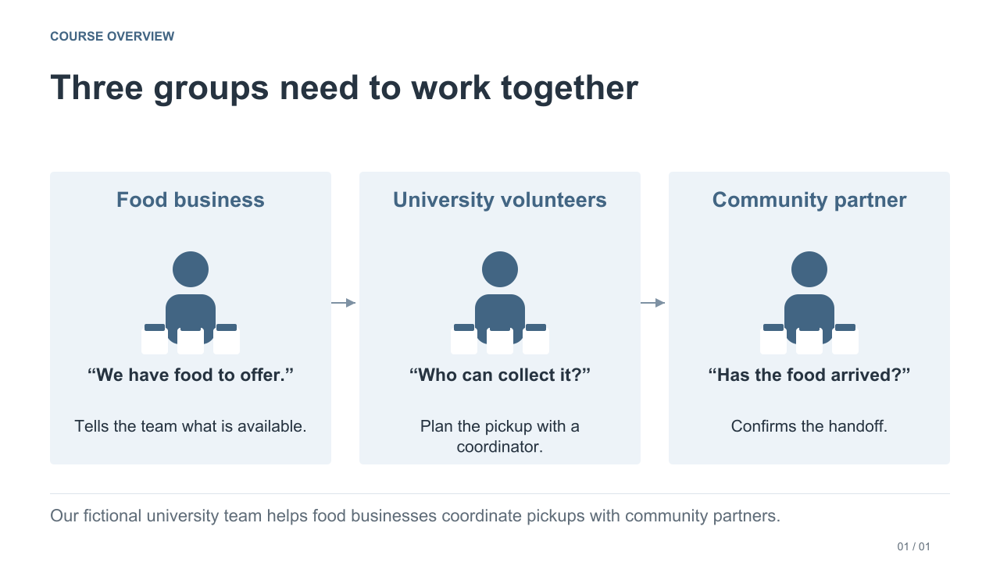

# Programming for Information Systems

⚠️ **Khmer text is automatically translated and may contain errors.** Use the English text as a reference and ask the instructor if meaning is unclear.

⚠️ **អត្ថបទខ្មែរបកប្រែដោយស្វ័យប្រវត្តិ ហើយអាចមានកំហុស។** សូមយោងអត្ថបទអង់គ្លេស ហើយសួរគ្រូបើអត្ថន័យមិនច្បាស់។

**Campus Food Rescue · Mengsay Loem · English-language course**

Learn to turn people’s needs into systems they can trust. **No programming background is needed to begin.** Start with a small calculation, then learn to check and save information for a fictional university food-pickup team.

[See the illustrated course story and ten-week route](COURSE_OVERVIEW.md). In the final project, you improve one small feature of a supplied application and let a classmate use it.

> **Updated 2026-11-07:** The illustrated course overview now starts with the people, one small program and one pickup. Weekly project introductions explain whose problem you are solving. Open your week directly in Colab and keep your own work backed up.

## Start here

1. **Prepare once:** follow the [setup guide](SETUP.md) for Colab or local Python/Jupyter.
2. **Open your week in Colab:** click its button below, then choose **File → Save a copy in Drive**. Weeks 1–2 need no upload; Weeks 3–10 need the matching ZIP in the setup cell.
3. **Work in your notebook copy:** follow **Start Here → Sessions 1–3 → Finish**. Write your predictions, code and checks in that notebook.
4. **Save and back up:** use the notebook's Finish checklist. The [weekly learning path](LEARNING_PATH.md) defines required work and when to stop.

Slides support the class explanation. The [assignment guide](assignments/README.md) separates **Programming tasks** (understand the Python topic through short experiments, then apply it) from **Research tasks** (investigate questions and explain with sources). The weekly PDF gives the steps, an example and a done checklist. [Python Basics](learning_materials/Python_Basics.ipynb) is an optional syntax lookup and is already included in every weekly ZIP.

## Weekly materials

<!-- COLAB_STATUS:START -->
Choose **Open in Colab** for your week below. It opens that exact notebook. Weeks 1–2 are self-contained: no notebook upload, ZIP, setup cell or extra files. Weeks 3–10 use the matching weekly ZIP and the setup cell for support files. Save a personal copy in Drive before editing.
<!-- COLAB_STATUS:END -->

<!-- WEEK_TABLE:START -->
| Week | Notebook | Slides | Run in Colab | Offline download |
|---|---|---|---|---|
| 1 · A clear pickup plan | [Notebook](learning_materials/Week_01.ipynb) | [Lesson](/slides/Week_01_Slides.pdf) · [Tasks](/assignments/Week_01_Assignments.pdf) |  **Before editing: File → Save a copy in Drive.** | [Notebook](/downloads/Week_01.ipynb) · [Optional ZIP](/downloads/Week_01.zip) |
| 2 · Review and dispatch | [Notebook](learning_materials/Week_02.ipynb) | [Lesson](/slides/Week_02_Slides.pdf) · [Tasks](/assignments/Week_02_Assignments.pdf) |  **Before editing: File → Save a copy in Drive.** | [Notebook](/downloads/Week_02.ipynb) · [Optional ZIP](/downloads/Week_02.zip) |
| 3 · Multi-batch pickup plans | [Notebook](learning_materials/Week_03.ipynb) | [Lesson](/slides/Week_03_Slides.pdf) · [Tasks](/assignments/Week_03_Assignments.pdf) |  **Before editing: File → Save a copy in Drive.** | [Notebook](/downloads/Week_03.ipynb) · [Required ZIP](/downloads/Week_03.zip) |
| 4 · Functions and testing | [Notebook](learning_materials/Week_04.ipynb) | [Lesson](/slides/Week_04_Slides.pdf) · [Tasks](/assignments/Week_04_Assignments.pdf) |  **Before editing: File → Save a copy in Drive.** | [Notebook](/downloads/Week_04.ipynb) · [Required ZIP](/downloads/Week_04.zip) |
| 5 · Offer data quality | [Notebook](learning_materials/Week_05.ipynb) | [Lesson](/slides/Week_05_Slides.pdf) · [Tasks](/assignments/Week_05_Assignments.pdf) |  **Before editing: File → Save a copy in Drive.** | [Notebook](/downloads/Week_05.ipynb) · [Required ZIP](/downloads/Week_05.zip) |
| 6 · Objects and persistent records | [Notebook](learning_materials/Week_06.ipynb) | [Lesson](/slides/Week_06_Slides.pdf) · [Tasks](/assignments/Week_06_Assignments.pdf) |  **Before editing: File → Save a copy in Drive.** | [Notebook](/downloads/Week_06.ipynb) · [Required ZIP](/downloads/Week_06.zip) |
| 7 · Reliable reservations | [Notebook](learning_materials/Week_07.ipynb) | [Lesson](/slides/Week_07_Slides.pdf) · [Tasks](/assignments/Week_07_Assignments.pdf) |  **Before editing: File → Save a copy in Drive.** | [Notebook](/downloads/Week_07.ipynb) · [Required ZIP](/downloads/Week_07.zip) |
| 8 · Reports and service integration | [Notebook](learning_materials/Week_08.ipynb) | [Lesson](/slides/Week_08_Slides.pdf) · [Tasks](/assignments/Week_08_Assignments.pdf) |  **Before editing: File → Save a copy in Drive.** | [Notebook](/downloads/Week_08.ipynb) · [Required ZIP](/downloads/Week_08.zip) |
| 9 · Your coordination improvement | [Notebook](learning_materials/Week_09.ipynb) | [Lesson](/slides/Week_09_Slides.pdf) · [Tasks](/assignments/Week_09_Assignments.pdf) |  **Before editing: File → Save a copy in Drive.** | [Notebook](/downloads/Week_09.ipynb) · [Required ZIP](/downloads/Week_09.zip) |
| 10 · Presentation, handoff and verification | [Notebook](learning_materials/Week_10.ipynb) | [Lesson](/slides/Week_10_Slides.pdf) · [Tasks](/assignments/Week_10_Assignments.pdf) |  **Before editing: File → Save a copy in Drive.** | [Notebook](/downloads/Week_10.ipynb) · [Required ZIP](/downloads/Week_10.zip) |
<!-- WEEK_TABLE:END -->

Weeks 1–2 also work locally as single `.ipynb` files: download the notebook from its page and open it in Jupyter. The ZIPs are optional offline packs with PDFs, Python Basics and shared reference files. For Weeks 3–10, download the matching ZIP and run the setup cell in Colab, or extract it locally and keep its folders together. See [Setup](SETUP.md) for saving and local installation.

## How the course fits together

| Session | Where you work | What you do |
|---|---|---|
| 1 · Learn Python | Weekly notebook | Read the explanation, trace the examples and check the syntax |
| 2 · Practise | Same notebook | Predict, run, change and repair examples; explain the Python rule |
| 3 · Project studio | Same notebook | Apply the skills, test the component and keep evidence |

The course has **10 weeks × three 90-minute sessions = 45 contact hours**. **Week 4:** the first 135 minutes finish the introductory core; the final 135 minutes are the Midterm. **Week 10:** Session 2 is the operator demonstration and Session 3 is individual verification. Exact calendar arrangements are announced separately.

Use the [learning path](LEARNING_PATH.md) for outside-class time: generally 30–60 minutes, 15–20 minutes of research preparation after the Week 4 Midterm, and about 60–75 minutes in Week 9. Supplied code and data are infrastructure; optional extensions can wait. Required programming uses Python's standard library.

## Course guides

| Need | Guide |
|---|---|
| Course purpose and system picture | [Illustrated overview](COURSE_OVERVIEW.md) · [Overview PDF](/slides/Course_Overview.pdf) |
| Orientation and people | [Orientation PDF](/slides/Orientation.pdf) · [Instructor](INSTRUCTOR.md) |
| Assessment and task requirements | [Assessment](ASSESSMENT.md) · [Assignment PDFs](assignments/README.md) · [Research guide](RESEARCH_ASSIGNMENTS.md) |
| Setup and current class links | [Setup](SETUP.md) · [Setup PDF](/slides/Setup.pdf) · [Course links](COURSE_LINKS.md) |
| Questions and peer checks | [Question guide](CONTRIBUTING.md) · [Local review sheet](learning_materials/LOCAL_REVIEW.md) |

## Class participation and your work

Ask questions in class or keep a small written example: input, expected result, observed result and a specific question. Once the course repository is announced, use its Issues for shared technical questions. [Open the weekly reflection and feedback form](https://forms.gle/Z3JhR3GHmHDWKxuN7) after class, selecting the correct teaching week. Submit a new response each week. See [Course links and reflection](COURSE_LINKS.md) for privacy and attendance guidance.

Use [submit.progmis@gmail.com](mailto:submit.progmis@gmail.com) for private submissions and personal course matters. Live-class access, exact file names and deadlines are announced separately. Keep complete assessed work, grades, attendance explanations and personal information out of shared Issues. Save your own working copy and a backup.

All course organizations, messages and quantities are fictional. Human coordinators approve suitability and arrangements. Planned portions are estimates; reservations, collection and delivery are distinct records.

## Public website edition

Weeks 1–10 notebooks, lesson PDFs and task briefings are available above. Shared support programs and Python Basics are reference infrastructure and can introduce later concepts.
