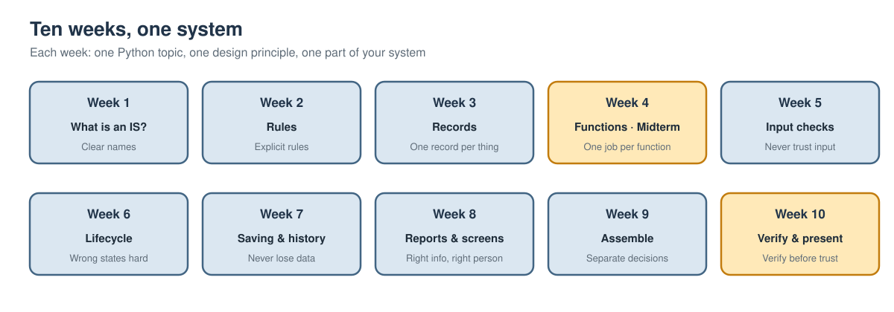

# Programming for Information Systems

**ភាសាខ្មែរ (Khmer):** [មេរៀនទាំងអស់ជាភាសាខ្មែរ](km/README.md)

**Campus FoodBridge · Instructor: [Mengsay Loem](https://loem-ms.github.io/) · English-language course for beginners**

## The morning the notebook failed

It is 8:10 on a busy morning at Campus FoodBridge, a university volunteer team that collects surplus food and delivers it to community partners. The phone keeps ringing. Sunrise Bakery has bread rolls that must be collected within two hours, a canteen has cooked rice, and a market stall has vegetables. As always, the coordinator writes each offer in a paper notebook.

By 8:40 the page is full. A phone number is written twice, one offer is squeezed into the margin and lost, and nobody can tell which partner was promised what. The food is real and the partners are waiting, but the paper notebook cannot keep up.

This course replaces that notebook. Week by week, you build a small information system that does what the notebook could not.

AI can now write a lot of code, and it gets better every year. But an AI cannot take responsibility for what a system does to people. The person who decides to use the code, or who chooses the rules and the approach, is responsible. In this course you learn Python basics so you can **read code, test it and judge it**, because you cannot take responsibility for code you do not understand. Each week you build one part of a small information system and make **your own decisions** about it. By Week 10 you have your own working system, and you can explain every choice in it.

**No programming background is needed.**

## How the course flows

The ten weeks follow the story of that notebook. Each week replaces one weakness of the paper notebook with one part of the system, and each part brings one principle with it.

- **Week 1 — [What is an information system?](notebooks/Week_01.ipynb)** · Clear names and units: you meet the finished system and learn to name things clearly, so nothing is a scribble that only one person understands.
- **Week 2 — [Rules and decisions](notebooks/Week_02.ipynb)** · Explicit rules: the decisions the coordinator kept in her head are written down as rules that are stated plainly and tested.
- **Week 3 — [Records and data](notebooks/Week_03.ipynb)** · One record per real thing: every offer gets one record of its own, so no phone number is written twice and no offer is lost in a margin.
- **Week 4 — [Functions you can trust · Your first files · Midterm](notebooks/Week_04.ipynb)** · One function, one job: the parts are built as small functions you can test and trust, moved into your first system files, and the Midterm checks the system so far.
- **Week 5 — [Checking input](notebooks/Week_05.ipynb)** · Never trust input: a wrong or incomplete offer is refused at the door, instead of being copied into the book and causing trouble later.
- **Week 6 — [Lifecycles](notebooks/Week_06.ipynb)** · Make wrong states hard to reach: an offer can only move through the steps that make sense, so a promise cannot quietly jump to the wrong state.
- **Week 7 — [Saving and history](notebooks/Week_07.ipynb)** · Never lose data: the day no longer disappears when the book is closed, and the history shows what was promised to whom.
- **Week 8 — [Reports, screens and a first chart](notebooks/Week_08.ipynb)** · Right information for the right person: the coordinator sees the full report and a first chart, while the public board shows no private phone numbers.
- **Week 9 — [Assemble and analyse](notebooks/Week_09.ipynb)** · Separate what changes from what stays: you analyse a semester of data for patterns and connect your files into one working system (menu and browser screen).
- **Week 10 — [Verify, hand over, present](notebooks/Week_10.ipynb)** · Verify before you trust: you test the finished system and hand it over, so the next coordinator can run the busy morning without you.

## Start here

1. **Set up once.** Read the [setup guide](SETUP.md). Google Colab works in the browser with nothing to install.
2. **Open your week.** Click **Open in Colab** in the table below, then **File → Save a copy in Drive** before you change anything.
3. **Run the setup cell**, then work through Sessions 1–3 and the Finish checklist.
4. **Look for ⭐ and ⭐⭐.** ⭐ is core work for everyone. ⭐⭐ is optional, for when you want to go further.

New here? Read the [course guide](COURSE_GUIDE.md) first: it explains the idea of the course, the system you will build and the ten design principles.

## Weekly materials

| Week | Principle | Read | Slides | Run | Download |
|---|---|---|---|---|---|
| **1** · What is an information system? | Clear names and units | [Notebook](notebooks/Week_01.ipynb) | [PDF](/slides/Week_01_Slides.pdf) |  | [.ipynb](/downloads/Week_01.ipynb) |
| **2** · Rules and decisions | Explicit rules | [Notebook](notebooks/Week_02.ipynb) | [PDF](/slides/Week_02_Slides.pdf) |  | [.ipynb](/downloads/Week_02.ipynb) |
| **3** · Records and data | One record per real thing | [Notebook](notebooks/Week_03.ipynb) | [PDF](/slides/Week_03_Slides.pdf) |  | [.ipynb](/downloads/Week_03.ipynb) |
| **4** · Functions you can trust · Your first files · Midterm | One function, one job | [Notebook](notebooks/Week_04.ipynb) | [PDF](/slides/Week_04_Slides.pdf) |  | [.ipynb](/downloads/Week_04.ipynb) |
| **5** · Checking input | Never trust input | [Notebook](notebooks/Week_05.ipynb) | [PDF](/slides/Week_05_Slides.pdf) |  | [.ipynb](/downloads/Week_05.ipynb) |
| **6** · Lifecycles | Make wrong states hard to reach | [Notebook](notebooks/Week_06.ipynb) | [PDF](/slides/Week_06_Slides.pdf) |  | [.ipynb](/downloads/Week_06.ipynb) |
| **7** · Saving and history | Never lose data | [Notebook](notebooks/Week_07.ipynb) | [PDF](/slides/Week_07_Slides.pdf) |  | [.ipynb](/downloads/Week_07.ipynb) |
| **8** · Reports, screens and charts | Right information for the right person | [Notebook](notebooks/Week_08.ipynb) | [PDF](/slides/Week_08_Slides.pdf) |  | [.ipynb](/downloads/Week_08.ipynb) |
| **9** · Assemble and analyse | Separate what changes from what stays | [Notebook](notebooks/Week_09.ipynb) | [PDF](/slides/Week_09_Slides.pdf) |  | [.ipynb](/downloads/Week_09.ipynb) |
| **10** · Verify, hand over, present | Verify before you trust | [Notebook](notebooks/Week_10.ipynb) | [PDF](/slides/Week_10_Slides.pdf) |  | [.ipynb](/downloads/Week_10.ipynb) |

**Before you edit a notebook in Colab: click Copy to Drive (or File → Save a copy in Drive).** Every notebook unpacks the course system itself; nothing to upload. The [FoodBridge kit ZIP](/downloads/foodbridge_kit.zip) is the complete system for running at home.

## Midterm, final project and reference

| | When | Read | Slides | Run |
|---|---|---|---|---|
| **Midterm · Campus Library Desk** | Week 4, Session 3 | [Exam info & PIN](MIDTERM.md) | [PDF](/slides/Midterm_Brief.pdf) | [🔒 Unlock with PIN](/exam/midterm.html) |
| **Final project · Your FoodBridge system** | Weeks 9–10 | [Notebook](notebooks/Final_Project.ipynb) | [PDF](/slides/Final_Project_Brief.pdf) |  |
| **Python Basics · Quick lookup (optional)** | any week | [Notebook](notebooks/Python_Basics.ipynb) | — |  |
| **Orientation** (first class) | Week 1 | [Course guide](COURSE_GUIDE.md) | [PDF](/slides/Orientation.pdf) | — |

## Course information

- [Course guide](COURSE_GUIDE.md): why this course, the ten principles, how a week works
- [Setup](SETUP.md): Colab or your own computer
- [Assessment](ASSESSMENT.md): how you are graded, and the rules for AI tools
- [Research tasks](RESEARCH.md): the six short research tasks and when they are shared
- [Final project](FINAL_PROJECT.md): the four levels, from "it runs" to "a screen"
- [Free Python & programming reading](COURSE_LINKS.md): optional free online books (PY4E, Automate the Boring Stuff, Think Python) and Python Tutor
- [Instructor](INSTRUCTOR.md) · [Course links & extra reading](COURSE_LINKS.md) · [Questions and help](CONTRIBUTING.md)

*Campus FoodBridge is fictional. All organisations, people and numbers in this course are invented.*
