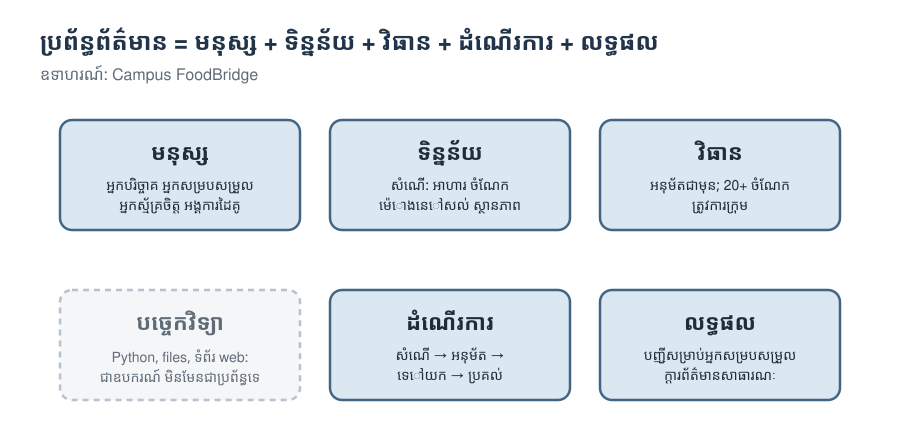

# មគ្គុទ្ទេសក៍វគ្គសិក្សា

## ហេតុអ្វីត្រូវរៀន programming នៅពេលដែល AI អាចសរសេរ code បាន?

ឧបករណ៍ AI សរសេរ code បានលឿន។ code ខ្លះល្អ។ code ខ្លះទៀត **run បាន ប៉ុន្តែមានហានិភ័យ**: វាលាក់វិធានមួយនៅក្នុងលេខដែលគ្មានឈ្មោះ (magic number) ធ្វើឱ្យបាត់ record មួយ បង្ហាញទិន្នន័យឯកជន ឬទទួលយក input ដែលគួរតែបដិសេធ។ ត្រូវតែមាននរណាម្នាក់កត់សម្គាល់ឃើញ។

វគ្គសិក្សានេះបង្រៀនអ្នកឱ្យក្លាយជាមនុស្សម្នាក់នោះ។ អ្នករៀន Python ឱ្យបានគ្រប់គ្រាន់ ដើម្បី:

1. **គិត** ដូចអ្នករចនាប្រព័ន្ធ: នរណាប្រើប្រព័ន្ធ វារក្សាទុកទិន្នន័យអ្វីខ្លះ និងវាអនុវត្តតាមវិធានណាខ្លះ។
2. **សរសេរ code** ផ្នែកតូចៗដោយខ្លួនឯង ដើម្បីឱ្យអ្នកយល់ពីរបៀបដែលវាដំណើរការ។
3. **វាយតម្លៃ** code (របស់អ្នកផ្ទាល់ ឬរបស់ AI) ថា *ល្អ* ឬ *មានហានិភ័យ* ដោយប្រើគោលការណ៍រចនាទាំងដប់។

## ប្រព័ន្ធដែលអ្នកបង្កើត: Campus FoodBridge

ក្រុមអ្នកស្ម័គ្រចិត្តនៃសាកលវិទ្យាល័យមួយ (ប្រឌិត) ប្រមូលអាហារដែលនៅសល់ពី **អ្នកបរិច្ចាគ** (ហាងនំបុ័ង អាហារដ្ឋាន តូបនៅផ្សារ) ហើយយកទៅប្រគល់ឱ្យ **អង្គការដៃគូក្នុងសហគមន៍** (មណ្ឌលកុមារ ផ្ទះបាយសហគមន៍ ក្រុមមនុស្សចាស់)។

- អ្នកបរិច្ចាគធ្វើ **សំណើ** (ផ្ដល់អាហារ) មួយ: អាហារអ្វី ប៉ុន្មាន **ចំណែក** និង **ម៉ោងនៅសល់** ប៉ុន្មាន មុនពេលត្រូវមកយក។
- ប្រព័ន្ធ **ពិនិត្យ** សំណើនៅមាត់ទ្វារ ហើយបដិសេធ input មិនត្រឹមត្រូវ ជាមួយសារច្បាស់លាស់មួយ។
- **អ្នកសម្របសម្រួល** (ជាមនុស្ស មិនមែន program ទេ) អនុម័ត ឬបដិសេធសំណើ ហើយជ្រើសរើសអង្គការដៃគូ។
- អ្នកស្ម័គ្រចិត្ត **ទៅយក** ហើយ **ប្រគល់** អាហារ។ ការផ្លាស់ប្ដូរនីមួយៗ ត្រូវបានរក្សាទុកក្នុង **ប្រវត្តិ**។
- អ្នកសម្របសម្រួលឃើញរបាយការណ៍ពេញលេញ។ សាធារណជនឃើញក្ដារព័ត៌មានដែលគ្មានទិន្នន័យឯកជន។

នៅសប្ដាហ៍ទី 1 អ្នក run ប្រព័ន្ធដែលបានបញ្ចប់រួចហើយ។ ចាប់ពីសប្ដាហ៍ទី 2 អ្នកបង្កើតផ្នែកមួយរបស់វា ក្នុងមួយសប្ដាហ៍។ ផ្នែកនីមួយៗមាន **ចំណុចកែតាមចិត្ត**: ការសម្រេចចិត្តដែលមានតែអ្នកទេអាចធ្វើបាន ដូចជា ពេលណាត្រូវការក្រុម ប្រភេទអាហារណាខ្លះត្រូវបានអនុញ្ញាត ឬសាធារណជនអាចឃើញអ្វីខ្លះ។ ត្រឹមសប្ដាហ៍ទី 10 ប្រព័ន្ធរបស់អ្នកខុសពីប្រព័ន្ធរបស់អ្នកដទៃ ហើយអ្នកអាចពន្យល់ពីមូលហេតុបាន។

## គោលការណ៍ទាំងដប់: វគ្គសិក្សាទាំងមូលក្នុងតារាងតែមួយ

| សប្ដាហ៍ | គោលការណ៍ | ក្នុងមួយប្រយោគ |
|---|---|---|
| 1 | **ឈ្មោះ និងឯកតាច្បាស់លាស់** | Code ត្រូវបានអានដោយមនុស្ស: ឈ្មោះមួយគួរប្រាប់ថា value មួយមានន័យអ្វី និងគិតជាឯកតាអ្វី។ |
| 2 | **វិធានច្បាស់លាស់** | ដាក់ឈ្មោះឱ្យលេខរបស់អ្នក គ្របដណ្ដប់គ្រប់ករណី ហើយ test boundary (ព្រំដែន)។ |
| 3 | **record មួយ សម្រាប់របស់ពិតមួយ** | របស់នីមួយៗមាន record មួយ និង ID មួយដែលមិនស្ទួនគ្នា។ កុំរក្សាទុកការពិតដដែលពីរដង។ |
| 4 | **function មួយ ការងារមួយ** | Return value ជំនួសឱ្យការ print វា។ test ករណីធម្មតា ករណី boundary និងករណីចម្លែក។ |
| 5 | **កុំទុកចិត្ត input** | ពិនិត្យនៅមាត់ទ្វារ ពន្យល់បញ្ហាជាពាក្យសាមញ្ញ ហើយមិនប្ដូរអ្វីទាំងអស់ ពេល input មិនត្រឹមត្រូវ។ |
| 6 | **ធ្វើឱ្យស្ថានភាពខុស កើតឡើងបានពិបាក** | អនុញ្ញាតតែការផ្លាស់ទីដែលសមហេតុផល។ ទុកវិធាននៅជាប់នឹងទិន្នន័យ។ |
| 7 | **កុំឱ្យបាត់បង់ទិន្នន័យ** | រក្សាទុកដោយសុវត្ថិភាព រក្សាប្រវត្តិ ហើយអាចពន្យល់បានថាមានអ្វីកើតឡើង។ |
| 8 | **ព័ត៌មានត្រឹមត្រូវ សម្រាប់មនុស្សត្រឹមត្រូវ** | លេខស្មោះត្រង់ ហើយទិន្នន័យឯកជនត្រូវរក្សាជាឯកជន។ |
| 9 | **បំបែកអ្វីដែលប្រែប្រួល ចេញពីអ្វីដែលនៅដដែល** | ទុកការសម្រេចចិត្ត (settings, វិធាន) ដាច់ដោយឡែកពីគ្រឿងម៉ាស៊ីន (ការរក្សាទុក អេក្រង់)។ |
| 10 | **ផ្ទៀងផ្ទាត់ មុននឹងទុកចិត្ត** | Test, ការ run ស្អាតពីដំបូង (clean run) និងការពិនិត្យ code (code review) ជាពិសេសសម្រាប់ code ដែល AI សរសេរ។ |

រៀងរាល់សប្ដាហ៍មានលំហាត់ **⚖️ ល្អ ឬមានហានិភ័យ?**: code ពីរកំណែ ដែល run បានទាំងពីរ។ អ្នកសម្រេចថាមួយណាល្អជាង ហើយពន្យល់មូលហេតុ ដោយប្រើគោលការណ៍នៃសប្ដាហ៍នោះ និងប្រាប់ថានរណានឹងរងគ្រោះ។

## ដប់សប្ដាហ៍

| សប្ដាហ៍ | ប្រធានបទ | Python ដែលអ្នករៀន | ផ្នែកដែលអ្នកបង្កើត | ការសម្រេចចិត្តរបស់អ្នក |
|---|---|---|---|---|
| 1 | តើប្រព័ន្ធព័ត៌មានជាអ្វី? | value, ឈ្មោះ, type, f-string | សេចក្ដីសង្ខេបនៃសំណើមួយ | ឈ្មោះប្រព័ន្ធ |
| 2 | វិធាន និងការសម្រេចចិត្ត | ការប្រៀបធៀប, `if`/`elif`/`else`, function ដំបូង | `pickup_label`, `urgency` | ទំហំក្រុម, ម៉ោងបន្ទាន់ |
| 3 | Records និងទិន្នន័យ | list, dictionary, `for` loop, ការបូកសរុប | `total_portions`, `find_offer` | ប្រភេទអាហារ |
| 4 | Functions ដែលអាចទុកចិត្តបាន · **Midterm** | `def`, `return`, docstring, test ដោយ `assert` | `open_portions` + test | status ណាខ្លះរាប់ថានៅបើក (open) |
| 5 | ការពិនិត្យ input | string, `int()`, `try`/`except` | `clean_offer` | កម្រិតកំណត់ និង field ដែលត្រូវតែមាន |
| 6 | Objects និង lifecycle | class, object, method | `can_move` | តើត្រូវការការអនុម័តឬអត់ |
| 7 | ការរក្សាទុក និងប្រវត្តិ | file, `with`, JSON | `to_record`, `from_record` | អ្វីដែលប្រវត្តិរក្សាទុក |
| 8 | របាយការណ៍ និងអេក្រង់ | sort ដោយប្រើ key, ការរៀបទម្រង់ (formatting), menu | `public_row`, `handle_choice` | អ្វីដែលសាធារណជនឃើញ |
| 9 | ការផ្គុំប្រព័ន្ធបញ្ចូលគ្នា | module, `import` | ប្រព័ន្ធទាំងមូលរបស់អ្នក | settings ទាំងអស់; ទំព័រ web (ស្រេចចិត្ត) |
| 10 | ផ្ទៀងផ្ទាត់ ប្រគល់ និងបង្ហាញ | test, clean run, code review | final project ដែលបានបញ្ចប់ | — |

## របៀបដែលមួយសប្ដាហ៍ដំណើរការ

សប្ដាហ៍នីមួយៗមានវគ្គបី (វគ្គនីមួយៗ 90 នាទី) និង notebook មួយ។

| ផ្នែក | អ្វីដែលកើតឡើង |
|---|---|
| **ចាប់ផ្ដើមថ្នាក់** | ចែករំលែកកិច្ចការស្រាវជ្រាវរបស់អ្នកជាក្រុមតូចៗ (សប្ដាហ៍ទី 2, 3 និង 5–8)។ |
| **វគ្គទី 1 · រៀន** | គំនិតមួយអំពីប្រព័ន្ធព័ត៌មាន បន្ទាប់មក Python សម្រាប់គំនិតនោះ: ពន្យល់, run, **ទាយមើល**, ពិនិត្យ។ |
| **វគ្គទី 2 · អនុវត្ត និងវាយតម្លៃ** | លំហាត់ខ្លីៗ បន្ទាប់មក **⚖️ ល្អ ឬមានហានិភ័យ?** |
| **វគ្គទី 3 · បង្កើត** | សរសេរផ្នែករបស់សប្ដាហ៍នេះ ពិនិត្យវា (✅/❌) ភ្ជាប់វាចូលប្រព័ន្ធពិត ហើយកត់ត្រា **ការសម្រេចចិត្តរបស់អ្នក**។ |
| **បញ្ចប់** | បញ្ជីត្រួតពិនិត្យ កិច្ចការស្រាវជ្រាវ (បើមាន) និងការមើលទៅសប្ដាហ៍ក្រោយ។ |

**កម្រិតអប្បបរមា តែងតែអាចសម្រេចបាន។** បើអ្នក run គ្រប់ cell ហើយធ្វើកិច្ចការ ⭐ រួច អ្នកនឹងមានផ្នែកមួយដែលដំណើរការបាន។ កិច្ចការ ⭐⭐ សម្រាប់ទៅឱ្យឆ្ងាយជាងនេះ ដោយគិតបន្ថែមបន្តិច។

## ការប្រើឧបករណ៍ AI

អ្នកអាចប្រើជំនួយការ AI ដើម្បី **ស្វែងយល់ និងសួរសំណួរ** លើកលែងតែក្នុង midterm និងកន្លែងដែលកិច្ចការណាមួយប្រាប់ផ្សេងពីនេះ។ អ្វីក៏ដោយដែលអ្នកដាក់ស្នើ (submit) អ្នកត្រូវតែអាចពន្យល់វាបាន។ ពេល AI ជួយអ្នក សូមពិនិត្យយ៉ាងហោចណាស់ការអះអាងមួយរបស់វាដោយខ្លួនឯង ហើយប្រាប់ថាអ្នកបានពិនិត្យដោយរបៀបណា។ វគ្គសិក្សានេះដាក់ពិន្ទុលើ **ការយល់ដឹង និងសមត្ថភាពវាយតម្លៃ** មិនមែនលើចំនួន code ទេ។
