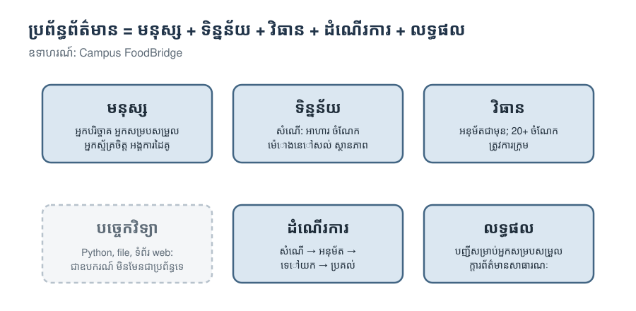

# មគ្គុទ្ទេសក៍វគ្គសិក្សា

## ហេតុអ្វីត្រូវរៀន programming នៅពេលដែល AI អាចសរសេរកូដបាន?

សព្វថ្ងៃ ឧបករណ៍ AI សរសេរកូដបានលឿន ហើយវាកាន់តែប្រសើរឡើងរៀងរាល់ឆ្នាំ។ កូដខ្លះរបស់វាល្អ។ កូដខ្លះទៀត **ដំណើរការបាន ប៉ុន្តែមានហានិភ័យ**: វាលាក់វិធានមួយនៅក្នុងលេខដែលសរសេរផ្ទាល់ (magic number) ធ្វើឱ្យបាត់ record មួយ បង្ហាញទិន្នន័យឯកជន ឬទទួលយក input ដែលគួរតែបដិសេធ។

ដូច្នេះ តើមានអ្វីនៅសល់សម្រាប់មនុស្សធ្វើ? ចម្លើយរបស់ខ្ញុំគឺ **ការទទួលខុសត្រូវ**។ សូមគិតថា AI ជា developer ម្នាក់ដែលធ្វើការលឿននៅក្នុងក្រុមរបស់អ្នក។ វាអាចស្នើកូដ ហើយសូម្បីតែការរចនាក៏បានដែរ។ ប៉ុន្តែវាមិនអាចទទួលខុសត្រូវចំពោះផលប៉ះពាល់ដែលប្រព័ន្ធមានលើមនុស្សបានទេ។ នៅពេលដែលប្រព័ន្ធមួយបង្ហាញលេខទូរស័ព្ទឯកជន ធ្វើឱ្យបាត់ record មួយ ឬបញ្ជូនអាហារដែលលែងមានសុវត្ថិភាព ត្រូវតែមាននរណាម្នាក់ទទួលខុសត្រូវ។ អ្នកនោះគឺជាអ្នកដែលបានសម្រេចចិត្តប្រើកូដនោះ ឬអ្នកដែលបានជ្រើសរើសវិធាន និងវិធីសាស្ត្រ: គឺអ្នកអភិវឌ្ឍប្រព័ន្ធ (systems developer) ឬអ្នកគ្រប់គ្រង (manager)។ នៅក្នុងការងាររបស់អ្នក មនុស្សម្នាក់នោះគឺជាអ្នក។

ការទទួលខុសត្រូវ ត្រូវការការយល់ដឹង។ អ្នកមិនអាចអនុម័តកូដ ដែលអ្នកអានមិនយល់ ឬការពារវិធានមួយ ដែលអ្នកខ្លួនឯងពន្យល់មិនបានទេ។ នេះហើយជាមូលហេតុដែលវគ្គសិក្សានេះនៅតែបង្រៀន Python: មិនមែនដើម្បីឱ្យអ្នកវាយកូដបានលឿនជាង AI នោះទេ ប៉ុន្តែដើម្បីឱ្យអ្នកដឹងថាអ្នកកំពុងទទួលយកអ្វី។ អ្នករៀន Python ឱ្យបានគ្រប់គ្រាន់ ដើម្បី:

1. **គិត** ដូចអ្នករចនាប្រព័ន្ធ: តើនរណាប្រើប្រព័ន្ធ តើវារក្សាទុកទិន្នន័យអ្វីខ្លះ និងតើវាអនុវត្តតាមវិធានណាខ្លះ។
2. **សរសេរកូដ** ផ្នែកតូចៗដោយខ្លួនឯង ដើម្បីឱ្យអ្នកយល់ពីរបៀបដែលវាដំណើរការ។
3. **វាយតម្លៃ** កូដ (របស់អ្នកផ្ទាល់ ឬរបស់ AI) ថា *ល្អ* ឬ *មានហានិភ័យ* ដោយប្រើគោលការណ៍រចនាទាំងដប់។

*Mengsay Loem, គ្រូបង្រៀន*

## ប្រព័ន្ធដែលអ្នកបង្កើត: Campus FoodBridge

មុនពេលមានប្រព័ន្ធណាមួយ ការផ្ដល់ជូន (offer) មកដល់តាមទូរស័ព្ទ ហើយត្រូវបានសរសេរក្នុងសៀវភៅកំណត់ត្រាក្រដាស។ នៅព្រឹកដ៏មមាញឹកមួយ សៀវភៅនោះបរាជ័យ។ ទូរស័ព្ទរោទ៍មិនឈប់ — Sunrise Bakery មាន Bread rolls (នំបុ័ង) ដែលត្រូវមកយកក្នុងរយៈពេលពីរម៉ោង អាហារដ្ឋានមួយមានបាយឆ្អិន ហើយតូបនៅផ្សារមួយមានបន្លែ — ហើយអ្នកសម្របសម្រួលសរសេរសំណើនីមួយៗ ចុះឱ្យលឿនតាមដែលអាចធ្វើបាន។ នៅពេលទំព័រសៀវភៅពេញ លេខទូរស័ព្ទមួយកត់ស្ទួនពីរដង សំណើមួយទៀតសរសេរប្រជ្រៀតនៅគែមទំព័ររហូតដល់មើលលែងឃើញ ហើយគ្មាននរណាដឹងថាបានសន្យាអ្វីជាមួយនរណានោះទេ។

វគ្គសិក្សានេះ ជំនួសសៀវភៅក្រដាសនោះ ក្នុងមួយសប្ដាហ៍ម្ដងមួយផ្នែក។ នេះគឺជាប្រព័ន្ធដែលអ្នកបង្កើត ដើម្បីជំនួសវា៖

ក្រុមអ្នកស្ម័គ្រចិត្តនៃសាកលវិទ្យាល័យមួយ (ប្រឌិត) ប្រមូលអាហារដែលនៅសល់ពី **អ្នកបរិច្ចាគ** (ហាងនំបុ័ង អាហារដ្ឋាន តូបនៅផ្សារ) ហើយយកទៅប្រគល់ឱ្យ **អង្គការដៃគូក្នុងសហគមន៍** (មណ្ឌលកុមារ ផ្ទះបាយសហគមន៍ ក្រុមមនុស្សចាស់)។

- អ្នកបរិច្ចាគធ្វើ **សំណើ** មួយ: អាហារអ្វី ប៉ុន្មាន **ចំណែក** និង **ម៉ោងនៅសល់** ប៉ុន្មាន មុនពេលត្រូវមកយក។
- ប្រព័ន្ធ **ពិនិត្យ** សំណើតាំងពីដំបូង (នៅច្រកពិនិត្យទិន្នន័យចូល) ហើយបដិសេធ input មិនត្រឹមត្រូវ ព្រមទាំងបង្ហាញសារបញ្ជាក់យ៉ាងច្បាស់។
- **អ្នកសម្របសម្រួល** (ជាមនុស្ស មិនមែនកម្មវិធីកុំព្យូទ័រទេ) អនុម័ត ឬបដិសេធសំណើ ហើយជ្រើសរើសអង្គការដៃគូ។
- អ្នកស្ម័គ្រចិត្ត **ទៅយក** ហើយ **ប្រគល់** អាហារ។ ការផ្លាស់ប្ដូរនីមួយៗ ត្រូវបានរក្សាទុកក្នុង **ប្រវត្តិ**។
- អ្នកសម្របសម្រួលឃើញរបាយការណ៍ពេញលេញ។ សាធារណជនឃើញក្ដារព័ត៌មានដែលគ្មានទិន្នន័យឯកជន។

នៅសប្ដាហ៍ទី 1 អ្នកដំណើរការប្រព័ន្ធដែលបានបញ្ចប់រួចហើយ។ ចាប់ពីសប្ដាហ៍ទី 2 អ្នកបង្កើតផ្នែកមួយរបស់វា ក្នុងមួយសប្ដាហ៍។ ផ្នែកនីមួយៗមាន **ចំណុចកែតាមចិត្ត**: ការសម្រេចចិត្តដែលមានតែអ្នកទេអាចធ្វើបាន ដូចជា ពេលណាត្រូវការក្រុម ប្រភេទអាហារណាខ្លះត្រូវបានអនុញ្ញាត ឬសាធារណជនអាចឃើញអ្វីខ្លះ។ ត្រឹមសប្ដាហ៍ទី 10 ប្រព័ន្ធរបស់អ្នកខុសពីប្រព័ន្ធរបស់អ្នកដទៃ ហើយអ្នកអាចពន្យល់ពីមូលហេតុបាន។

## គោលការណ៍ទាំងដប់: វគ្គសិក្សាទាំងមូលក្នុងតារាងតែមួយ

គោលការណ៍នីមួយៗ គឺជាទម្លាប់មួយរបស់ developer ដែលទទួលខុសត្រូវ។ ពួកវារួមគ្នាជួយអ្នកពិនិត្យប្រព័ន្ធមួយ មុនពេលអ្នកទទួលយកវា។

| សប្ដាហ៍ | គោលការណ៍ | ក្នុងមួយប្រយោគ |
|---|---|---|
| 1 | **ឈ្មោះ និងឯកតាច្បាស់លាស់** | មនុស្សជាអ្នកអានកូដ: ឈ្មោះ variable គួរប្រាប់ឱ្យច្បាស់ថា តម្លៃ (value) នោះមានន័យអ្វី និងគិតជាឯកតាអ្វី។ |
| 2 | **វិធានច្បាស់លាស់** | ដាក់ឈ្មោះឱ្យលេខរបស់អ្នក គ្របដណ្ដប់គ្រប់ករណី ហើយសាកល្បងនៅចំណុចព្រំដែន។ |
| 3 | **record មួយ សម្រាប់របស់ពិតមួយ** | របស់នីមួយៗមាន record មួយ និង ID មួយដែលមិនស្ទួនគ្នា។ កុំរក្សាទុកការពិតដដែលពីរដង។ |
| 4 | **function មួយ ការងារមួយ** | ចូរ return តម្លៃ ជំនួសឱ្យការ print វា។ ចូរសាកល្បងករណីធម្មតា (normal case) ករណីព្រំដែន (edge case) និងករណីចម្លែក។ |
| 5 | **កុំទុកចិត្ត input** | ពិនិត្យទិន្នន័យមុនទទួលចូលប្រព័ន្ធ ពន្យល់បញ្ហាជាពាក្យសាមញ្ញ ហើយមិនប្ដូរអ្វីទាំងអស់ ពេល input មិនត្រឹមត្រូវ។ |
| 6 | **ទប់ស្កាត់កុំឱ្យកើតស្ថានភាពខុស** | អនុញ្ញាតតែការប្ដូរស្ថានភាពដែលសមហេតុផល។ ដាក់វិធានឱ្យនៅជាប់នឹងទិន្នន័យ។ |
| 7 | **កុំឱ្យបាត់បង់ទិន្នន័យ** | រក្សាទុកដោយសុវត្ថិភាព រក្សាប្រវត្តិ ហើយអាចពន្យល់បានថាមានអ្វីកើតឡើង។ |
| 8 | **ព័ត៌មានត្រឹមត្រូវ សម្រាប់មនុស្សត្រឹមត្រូវ** | តួលេខត្រូវឆ្លុះបញ្ចាំងការពិត ហើយទិន្នន័យឯកជនត្រូវរក្សាទុកជាឯកជន។ |
| 9 | **បំបែកអ្វីដែលប្រែប្រួល ចេញពីអ្វីដែលនៅដដែល** | ទុកការសម្រេចចិត្ត (settings, វិធាន) ឱ្យដាច់ពីផ្នែកដំណើរការប្រព័ន្ធ (ការរក្សាទុកទិន្នន័យ និងអេក្រង់បង្ហាញ)។ |
| 10 | **ផ្ទៀងផ្ទាត់ មុននឹងទុកចិត្ត** | ធ្វើតេស្ត (test), run កូដសាជាថ្មីទាំងអស់ពីដើម (clean run) និងត្រួតពិនិត្យកូដ (code review) ជាពិសេសកូដដែល AI សរសេរ។ |

រៀងរាល់សប្ដាហ៍មានលំហាត់ **⚖️ ល្អ ឬមានហានិភ័យ?**: កូដពីរកំណែ (version) ដែលដំណើរការបានទាំងពីរ។ អ្នកសម្រេចថាមួយណាល្អជាង ហើយពន្យល់មូលហេតុ ដោយប្រើគោលការណ៍នៃសប្ដាហ៍នោះ និងប្រាប់ថានរណានឹងរងផលប៉ះពាល់។

## ដប់សប្ដាហ៍

សូមអានតារាងនេះ ជាដំណើរមួយដែលចាប់ផ្ដើមពីសៀវភៅក្រដាស។ នៅសប្ដាហ៍ទី 1 អ្នកជួបប្រព័ន្ធដែលបានបញ្ចប់ ដែលជំនួសសៀវភៅនោះ។ ចាប់ពីសប្ដាហ៍ទី 2 អ្នកបង្កើតប្រព័ន្ធនោះឡើងវិញដោយខ្លួនឯង ក្នុងមួយសប្ដាហ៍ម្ដងមួយផ្នែក៖ ដំបូងគឺវិធានដែលសៀវភៅទុកក្នុងចិត្តរបស់មនុស្ស បន្ទាប់មក record មួយសម្រាប់សំណើពិតនីមួយៗ បន្ទាប់មក function ដែលអាចទុកចិត្តបាន ការពិនិត្យទិន្នន័យមុនទទួលចូល lifecycle ដែលមានសុវត្ថិភាព ការរក្សាទុក និងប្រវត្តិ និងរបាយការណ៍សម្រាប់អ្នកអានដែលត្រឹមត្រូវ។ សប្ដាហ៍នីមួយៗ លុបបំបាត់វិធីមួយ ដែលសៀវភៅបានបរាជ័យនៅព្រឹកដ៏មមាញឹកនោះ។

| សប្ដាហ៍ | ប្រធានបទ | Python ដែលអ្នករៀន | ផ្នែកដែលអ្នកបង្កើត | ការសម្រេចចិត្តរបស់អ្នក |
|---|---|---|---|---|
| 1 | [តើប្រព័ន្ធព័ត៌មានជាអ្វី?](notebooks/Week_01.ipynb) | តម្លៃ (value), ឈ្មោះ, type, f-string | សេចក្ដីសង្ខេបនៃសំណើមួយ | ឈ្មោះប្រព័ន្ធ |
| 2 | [វិធាន និងការសម្រេចចិត្ត](notebooks/Week_02.ipynb) | ការប្រៀបធៀប, `if`/`elif`/`else`, function ដំបូង | `pickup_label`, `urgency` | ទំហំក្រុម, ម៉ោងបន្ទាន់ |
| 3 | [Records និងទិន្នន័យ](notebooks/Week_03.ipynb) | list, dictionary, `for` loop, ការបូកសរុប | `total_portions`, `find_offer` | ប្រភេទអាហារ |
| 4 | [Functions ដែលអាចទុកចិត្តបាន · file ដំបូងរបស់អ្នក · **Midterm**](notebooks/Week_04.ipynb) | `def`, `return`, docstring, តេស្ត (test) ដោយ `assert`, ការបង្កើត file `.py` | `rules.py`, `records.py` (`open_portions`) | តម្លៃថេរវិធានក្នុង `rules.py` |
| 5 | [ការពិនិត្យ input](notebooks/Week_05.ipynb) | method របស់ string, `int()`, exception, `try`/`except`, បញ្ជី error, ការ return តម្លៃពីរ | `data_model.py`: `clean_offer` | កម្រិតកំណត់ និង field ដែលត្រូវតែមាន |
| 6 | [Lifecycle](notebooks/Week_06.ipynb) | dict នៃ list, `in`, `.get()`, `while` loop, ការអាន class មួយ | `lifecycle.py`: `ALLOWED_MOVES`, `can_move` | តើត្រូវការការអនុម័តឬអត់ |
| 7 | [ការរក្សាទុក និងប្រវត្តិ](notebooks/Week_07.ipynb) | អង្គចងចាំ (memory) និងថាស (disk), file, `with`, JSON, JSON Lines, ការរក្សាទុកដោយសុវត្ថិភាព | `storage.py`: រក្សាទុក, ទាញយកមកវិញ (load), ប្រវត្តិ | អ្វីដែលប្រវត្តិរក្សាទុក |
| 8 | [របាយការណ៍ អេក្រង់ និងក្រាហ្វដំបូង](notebooks/Week_08.ipynb) | `sorted` ដោយប្រើ key, slice, ការរាប់បញ្ចូលក្នុង dictionary, ក្រាហ្វរបារ (bar chart) ដំបូងរបស់អ្នក | `report.py` | អ្វីដែលសាធារណជនឃើញ |
| 9 | [ការផ្គុំប្រព័ន្ធ និងការវិភាគទិន្នន័យ](notebooks/Week_09.ipynb) | `import`, function ដែលហៅ function ផ្សេងទៀត, `if __name__ == "__main__"`, menu loop; ទិន្នន័យសម្រាប់ការសម្រេចចិត្ត | `app.py` (menu + អេក្រង់ browser) និងផែនការគម្រោង (project charter) របស់អ្នក | settings ទាំងអស់ |
| 10 | [ផ្ទៀងផ្ទាត់ ផ្ទេរការងារ និងបង្ហាញ](notebooks/Week_10.ipynb) | `test_…()` ក្នុង `tests.py`, clean run, ការអានកូដដែល AI សរសេរ | `tests.py`, របាយការណ៍របស់អ្នក, ថ្ងៃបង្ហាញប្រព័ន្ធ (Demo day) | — |

ត្រឹមសប្ដាហ៍ទី 9 ផ្នែកទាំងអស់ ដំណើរការជាមួយគ្នាជាប្រព័ន្ធតែមួយ ដោយមានការសម្រេចចិត្តផ្ទាល់ខ្លួនរបស់អ្នកនៅក្នុងវា។ សប្ដាហ៍ទី 10 បិទដំណើរនេះ៖ អ្នកផ្ទៀងផ្ទាត់ប្រព័ន្ធ មុននឹងទុកចិត្តវា ហើយផ្ទេរវាទៅ ដើម្បីឱ្យអ្នកផ្សេង អាចដំណើរការព្រឹកដ៏មមាញឹកនោះបាន។ ចំណុចខ្សោយចុងក្រោយរបស់សៀវភៅក្រដាស — ដែលមានតែអ្នកសរសេរវាទេ អាចប្រើវាបាន — ក៏បាត់ទៅដែរ។

## របៀបដែលមួយសប្ដាហ៍ដំណើរការ

សប្ដាហ៍នីមួយៗមានវគ្គបី (វគ្គនីមួយៗ 90 នាទី) និង notebook មួយ។ ចាប់ពីសប្ដាហ៍ទី 4 តទៅ សប្ដាហ៍នីមួយៗមានទម្រង់ដូចគ្នា៖

| ផ្នែក | អ្វីដែលកើតឡើង |
|---|---|
| **ចាប់ផ្ដើមថ្នាក់** | ចែករំលែកកិច្ចការស្រាវជ្រាវរបស់អ្នកជាក្រុមតូចៗ (សប្ដាហ៍ទី 2, 3 និង 5–8)។ |
| **វគ្គទី 1 · ស្វែងយល់** | គំនិតមួយអំពីប្រព័ន្ធព័ត៌មាន បន្ទាប់មកគោលគំនិត (concept) របស់ Python ចំនួនបួន ឬប្រាំ។ គោលគំនិតនីមួយៗត្រូវបាន **ពន្យល់** (វាជាអ្វី ហេតុអ្វីបានជាត្រូវការវា តើ Python ដំណើរការវាយ៉ាងដូចម្ដេច និងតើអ្នកជួបវានៅកន្លែងណាក្នុង app ពិតៗ) បង្ហាញក្នុង **ឧទាហរណ៍** ខ្លីមួយ ដែលអ្នក **ទាយមើល** មុនពេល run ហើយអនុវត្តក្នុង **✍️ សាកសរសេរ**។ ចាប់ពីសាកសរសេរទី 2 អ្នកសរសេរករណីតេស្ត (test case) ខ្លះដោយខ្លួនឯង។ អ្នកបញ្ចប់វគ្គដោយសំណួរ **🔁 ពន្យល់ឡើងវិញតាមពាក្យរបស់អ្នក** ចំនួនបី។ |
| **វគ្គទី 2 · អនុវត្ត រួចមើលពីខាងក្នុង** | ដំបូង អ្នកអនុវត្ត៖ ប័ណ្ណការងារសប្ដាហ៍នេះ (ticket), គូរគំរូលើក្រដាស និងលំហាត់តាមកម្រិត (ladder) ខ្លីមួយ (ល្បែងផ្គុំកូដ → សរសេរកូដ)។ បន្ទាប់មក អ្នកមើល **ពីខាងក្នុង (under the hood)** ជាមួយគ្រូ៖ តើ file របស់សប្ដាហ៍នេះដំណើរការយ៉ាងដូចម្ដេច តើមានអ្វីកើតឡើង ប្រសិនបើអ្វីមួយផ្លាស់ប្ដូរ និង **⚖️ ល្អ ឬមានហានិភ័យ?** |
| **វគ្គទី 3 · បង្កើត និងសម្រេចចិត្ត** | សរសេរ file របស់សប្ដាហ៍នេះក្នុង `my_foodbridge/` ពិនិត្យវា (✅/❌) មើលប្រព័ន្ធរបស់អ្នក (`bridge.show`) ធ្វើ **ការសម្រេចចិត្តរបស់អ្នក** ដោយមានភស្តុតាង (evidence) ពីទិន្នន័យ ហើយសរសេរបីបន្ទាត់ក្នុង **📓 កំណត់ហេតុគម្រោង (project journal)** របស់អ្នក។ |
| **បញ្ចប់** | បញ្ជីត្រួតពិនិត្យ, **📚 អានបន្ថែម** (ផ្នែកមួយនៃ Python Basics និងជំពូកមួយនៃសៀវភៅឥតគិតថ្លៃ), កិច្ចការស្រាវជ្រាវ (ប្រសិនបើមាន) និងការមើលទៅសប្ដាហ៍ក្រោយ។ |

សប្ដាហ៍ទី 1–3 ក៏មានទម្រង់នេះដែរ តែស្រាលជាង៖ អ្នកសរសេរកូដក្នុង cell របស់ notebook ជំនួសឱ្យក្នុង file។

**កម្រិតអប្បបរមា តែងតែអាចសម្រេចបាន។** ប្រសិនបើអ្នក run គ្រប់ cell ហើយធ្វើកិច្ចការ ⭐ រួចរាល់ អ្នកនឹងមានផ្នែកមួយដែលដំណើរការបាន។ កិច្ចការ ⭐⭐ (យ៉ាងច្រើនពីរក្នុងមួយសប្ដាហ៍) គឺសម្រាប់អ្នកដែលចង់ទៅឱ្យឆ្ងាយជាងនេះ ដោយគិតបន្ថែមបន្តិច។

## កិច្ចការស្រាវជ្រាវ

កិច្ចការស្រាវជ្រាវខ្លីៗចំនួនប្រាំមួយ (5% ក្នុងមួយកិច្ចការ) នាំវគ្គសិក្សាចេញទៅក្រៅ notebook។ ក្នុង R1 និង R2 អ្នកពិនិត្យមើលប្រព័ន្ធពិតមួយដែលអ្នកស្គាល់។ ចាប់ពីសប្ដាហ៍ទី 4 R3–R6 នីមួយៗបង្រៀនអ្នកអំពីគោលគំនិតមួយនៃការសរសេរកម្មវិធី (programming concept) មុនពេលអ្នកត្រូវការវា តាមសកម្មភាពបួន៖ **អាន** (ផ្នែកមួយនៃ Python Basics និងជំពូកមួយនៃសៀវភៅឥតគិតថ្លៃ), **សួរ** AI អំពីចំណុចដែលនៅមិនទាន់ច្បាស់, **ពិនិត្យ** ការអះអាងមួយ ដោយ run ឧទាហរណ៍តូចមួយ និង **សម្រេចចិត្ត**៖ បញ្ចេញមតិផ្ទាល់ខ្លួនរបស់អ្នក ចំពោះសំណួរមួយដែលគ្មានចម្លើយត្រឹមត្រូវតែមួយ ដូចជា *"តើកម្មវិធីកុំព្យូទ័រគួរគាំង ឬបន្តដំណើរការដោយស្មានយកចម្លើយមួយ?"* សូមមើល [កិច្ចការស្រាវជ្រាវ](RESEARCH.md)។

## Final project របស់អ្នក

Final project របស់អ្នក គឺ folder `my_foodbridge/` ផ្ទាល់ខ្លួនរបស់អ្នក ហើយវារីកធំឡើងបន្តិចម្ដងៗជាមួយអ្នក ចាប់ពីសប្ដាហ៍ទី 5៖

- **សប្ដាហ៍ទី 5–9:** សប្ដាហ៍នីមួយៗបញ្ចប់ដោយការសរសេរបីបន្ទាត់ក្នុង 📓 កំណត់ហេតុគម្រោងរបស់អ្នក៖ ឥឡូវនេះប្រព័ន្ធរបស់អ្នកធ្វើអ្វីបាន ការសម្រេចចិត្តមួយដែលអ្នកបានធ្វើ និងគំនិតមួយសម្រាប់ Final project របស់អ្នក។
- **សប្ដាហ៍ទី 8:** អ្នកជ្រើសរើស **ផ្នែកបន្ថែម (extension)** មួយរបស់អ្នកផ្ទាល់ ឧទាហរណ៍ វិធានថ្មីមួយ ទិដ្ឋភាពអ្នកស្ម័គ្រចិត្ត ឬសេចក្ដីសង្ខេបប្រចាំសប្ដាហ៍។
- **សប្ដាហ៍ទី 9:** អ្នកសរសេរ **ផែនការគម្រោង (project charter)** ប្រវែងកន្លះទំព័រ៖ នរណាខ្លះជាអ្នកប្រើប្រព័ន្ធរបស់អ្នក ការសម្រេចចិត្តទាំងបីរបស់អ្នករហូតមកដល់ពេលនេះ ផ្នែកបន្ថែមរបស់អ្នក និងរបៀបដែលអ្នកនឹងសាកល្បងវា ព្រមទាំងគំនូរដំបូងនៃប្រព័ន្ធរបស់អ្នក។
- **សប្ដាហ៍ទី 10:** អ្នកដាក់ស្នើប្រព័ន្ធរបស់អ្នក និង **របាយការណ៍** ខ្លីមួយ (ប្រហែលពីរទំព័រ) រួចបង្ហាញវានៅ **Demo day**៖ បីនាទី ជាមួយផ្ទាំងបង្ហាញប្រព័ន្ធ (system poster) របស់អ្នក ការកែប្រែផ្ទាល់ (live change) មួយ និងសំណួរមួយ។

សូមមើល [មគ្គុទ្ទេសក៍ Final project](FINAL_PROJECT.md)។

## ការប្រើឧបករណ៍ AI

អ្នកអាចប្រើជំនួយការ AI ដើម្បី **ស្វែងយល់ និងសួរសំណួរ** លើកលែងតែក្នុង midterm និងកន្លែងដែលកិច្ចការណាមួយប្រាប់ផ្សេងពីនេះ។ ក្នុងកិច្ចការស្រាវជ្រាវ R3–R6 អ្នកអានជាមុនសិន បន្ទាប់មកសួរ AI ដោយមានគោលបំណងច្បាស់ អំពីចំណុចដែលនៅមិនទាន់ច្បាស់ ហើយបន្ទាប់មកទៀត ពិនិត្យអ្វីដែលវាបាននិយាយ។ អ្វីក៏ដោយដែលអ្នកដាក់ស្នើ (submit) អ្នកត្រូវតែអាចពន្យល់វាបាន: ប្រសិនបើអ្នកដាក់ស្នើវា អ្នកជាអ្នកទទួលខុសត្រូវចំពោះវា ទោះបីនរណាជាអ្នកសរសេរវាក៏ដោយ។ ពេល AI ជួយអ្នក សូមពិនិត្យយ៉ាងហោចណាស់ការអះអាងមួយរបស់វាដោយខ្លួនឯង ហើយប្រាប់ថាអ្នកបានពិនិត្យដោយរបៀបណា។ វគ្គសិក្សានេះដាក់ពិន្ទុលើ **ការយល់ដឹង និងការវិនិច្ឆ័យ** មិនមែនលើចំនួនកូដទេ។
