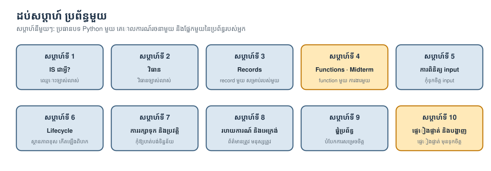

# Programming for Information Systems

**English:** [the same course in English](../README.md)

**Campus FoodBridge · គ្រូបង្រៀន: [Mengsay Loem](https://loem-ms.github.io/) · កំណែភាសាខ្មែរ សម្រាប់អ្នកចាប់ផ្ដើមដំបូង**

ពាក្យ programming និងពាក្យបច្ចេកទេស រក្សាជាភាសាអង់គ្លេសដោយចេតនា ព្រោះនៅកម្ពុជា មិនទាន់មានពាក្យបច្ចេកទេសជាភាសាខ្មែរ ដែលគេឯកភាពគ្នានៅឡើយ។

សព្វថ្ងៃ AI អាចសរសេរ code បានច្រើន ហើយវាកាន់តែប្រសើរឡើងរៀងរាល់ឆ្នាំ។ ប៉ុន្តែ AI មិនអាចទទួលខុសត្រូវចំពោះផលប៉ះពាល់ដែលប្រព័ន្ធមួយមានលើមនុស្សបានទេ។ អ្នកដែលសម្រេចចិត្តប្រើ code នោះ ឬអ្នកដែលជ្រើសរើសវិធាន និងវិធីសាស្ត្រ គឺជាអ្នកទទួលខុសត្រូវ។ ក្នុងវគ្គសិក្សានេះ អ្នករៀនមូលដ្ឋាន Python ដើម្បីឱ្យអ្នកអាច **អាន code, test វា និងវាយតម្លៃវា** ព្រោះអ្នកមិនអាចទទួលខុសត្រូវចំពោះ code ដែលអ្នកមិនយល់បានទេ។ រៀងរាល់សប្ដាហ៍ អ្នកបង្កើតផ្នែកមួយនៃប្រព័ន្ធព័ត៌មានតូចមួយ ហើយធ្វើ **ការសម្រេចចិត្តផ្ទាល់ខ្លួនរបស់អ្នក** អំពីផ្នែកនោះ។ ត្រឹមសប្ដាហ៍ទី 10 អ្នកនឹងមានប្រព័ន្ធផ្ទាល់ខ្លួនរបស់អ្នក ដែលដំណើរការបាន ហើយអ្នកអាចពន្យល់ពីការជ្រើសរើសនីមួយៗនៅក្នុងវាបាន។

**មិនត្រូវការចំណេះដឹង programming ពីមុនទេ។**

## ចាប់ផ្ដើមនៅទីនេះ

1. **រៀបចំតែម្ដង។** អាន [មគ្គុទ្ទេសក៍ការរៀបចំ (setup)](SETUP.md)។ Google Colab ដំណើរការក្នុង browser ដោយមិនចាំបាច់ install អ្វីទេ។
2. **បើកសប្ដាហ៍របស់អ្នក។** ចុច **Open in Colab** ក្នុងតារាងខាងក្រោម បន្ទាប់មក **File → Save a copy in Drive** មុននឹងកែប្រែអ្វីមួយ។
3. **Run setup cell** បន្ទាប់មកធ្វើតាមវគ្គទី 1–3 និងបញ្ជីត្រួតពិនិត្យនៅផ្នែកបញ្ចប់។
4. **រកមើល ⭐ និង ⭐⭐។** ⭐ ជាការងារមូលដ្ឋាន សម្រាប់គ្រប់គ្នា។ ⭐⭐ ជាការងារបន្ថែម (ស្រេចចិត្ត) សម្រាប់ពេលអ្នកចង់ទៅឱ្យឆ្ងាយជាងនេះ។

ទើបមកដល់ថ្មី? សូមអាន [មគ្គុទ្ទេសក៍វគ្គសិក្សា](COURSE_GUIDE.md) មុនសិន: វាពន្យល់អំពីគំនិតរបស់វគ្គសិក្សា ប្រព័ន្ធដែលអ្នកនឹងបង្កើត និងគោលការណ៍រចនាទាំងដប់។

## ឯកសារប្រចាំសប្ដាហ៍

| សប្ដាហ៍ | គោលការណ៍ | អាន | ស្លាយ | Run | ទាញយក |
|---|---|---|---|---|---|
| **1** · តើប្រព័ន្ធព័ត៌មានជាអ្វី? | ឈ្មោះ និងឯកតាច្បាស់លាស់ | [Notebook](notebooks/Week_01.ipynb) | [PDF](/slides/km/Week_01_Slides.pdf) |  | [.ipynb](/downloads/km/Week_01.ipynb) |
| **2** · វិធាន និងការសម្រេចចិត្ត | វិធានច្បាស់លាស់ | [Notebook](notebooks/Week_02.ipynb) | [PDF](/slides/km/Week_02_Slides.pdf) |  | [.ipynb](/downloads/km/Week_02.ipynb) |
| **3** · Records និងទិន្នន័យ | record មួយ សម្រាប់របស់ពិតមួយ | [Notebook](notebooks/Week_03.ipynb) | [PDF](/slides/km/Week_03_Slides.pdf) |  | [.ipynb](/downloads/km/Week_03.ipynb) |
| **4** · Functions ដែលអាចទុកចិត្តបាន · Midterm | function មួយ ការងារមួយ | [Notebook](notebooks/Week_04.ipynb) | [PDF](/slides/km/Week_04_Slides.pdf) |  | [.ipynb](/downloads/km/Week_04.ipynb) |
| **5** · ការពិនិត្យ input | កុំទុកចិត្ត input | [Notebook](notebooks/Week_05.ipynb) | [PDF](/slides/km/Week_05_Slides.pdf) |  | [.ipynb](/downloads/km/Week_05.ipynb) |
| **6** · Objects និង lifecycle | ធ្វើឱ្យស្ថានភាពខុស កើតឡើងបានពិបាក | [Notebook](notebooks/Week_06.ipynb) | [PDF](/slides/km/Week_06_Slides.pdf) |  | [.ipynb](/downloads/km/Week_06.ipynb) |
| **7** · ការរក្សាទុក និងប្រវត្តិ | កុំឱ្យបាត់បង់ទិន្នន័យ | [Notebook](notebooks/Week_07.ipynb) | [PDF](/slides/km/Week_07_Slides.pdf) |  | [.ipynb](/downloads/km/Week_07.ipynb) |
| **8** · របាយការណ៍ និងអេក្រង់ | ព័ត៌មានត្រឹមត្រូវ សម្រាប់មនុស្សត្រឹមត្រូវ | [Notebook](notebooks/Week_08.ipynb) | [PDF](/slides/km/Week_08_Slides.pdf) |  | [.ipynb](/downloads/km/Week_08.ipynb) |
| **9** · ការផ្គុំប្រព័ន្ធបញ្ចូលគ្នា | បំបែកអ្វីដែលប្រែប្រួល ចេញពីអ្វីដែលនៅដដែល | [Notebook](notebooks/Week_09.ipynb) | [PDF](/slides/km/Week_09_Slides.pdf) |  | [.ipynb](/downloads/km/Week_09.ipynb) |
| **10** · ផ្ទៀងផ្ទាត់ ប្រគល់ និងបង្ហាញ | ផ្ទៀងផ្ទាត់ មុននឹងទុកចិត្ត | [Notebook](notebooks/Week_10.ipynb) | [PDF](/slides/km/Week_10_Slides.pdf) |  | [.ipynb](/downloads/km/Week_10.ipynb) |

**មុននឹងកែ notebook ក្នុង Colab: ចុចលើពាក្យ Copy to Drive (ឬ ចូលទៅកាន់ File រួចចុច Save a copy in Drive)។** notebook នីមួយៗដកយក (unpack) ប្រព័ន្ធរបស់វគ្គសិក្សាដោយខ្លួនឯង មិនបាច់ upload អ្វីទេ។ [FoodBridge kit ZIP](/downloads/foodbridge_kit.zip) គឺជាប្រព័ន្ធពេញលេញ សម្រាប់ run នៅផ្ទះ (ដាក់ `LANGUAGE = "km"` ក្នុង `my_settings.py` ដើម្បីឃើញអេក្រង់ជាភាសាខ្មែរ)។

## Midterm, final project និងឯកសារយោង

| | ពេលណា | អាន | ស្លាយ | Run |
|---|---|---|---|---|
| **Midterm · រៀបចំផែនការសម្រាប់មួយថ្ងៃ** | សប្ដាហ៍ទី 4 · វគ្គទី 3 | [Notebook](notebooks/Midterm.ipynb) | [PDF](/slides/km/Midterm_Brief.pdf) |  |
| **Final project · ប្រព័ន្ធ FoodBridge របស់អ្នក** | សប្ដាហ៍ទី 9–10 | [Notebook](notebooks/Final_Project.ipynb) | [PDF](/slides/km/Final_Project_Brief.pdf) |  |
| **Python Basics · មើលរហ័ស (ស្រេចចិត្ត)** | សប្ដាហ៍ណាក៏បាន | [Notebook](notebooks/Python_Basics.ipynb) | — |  |
| **ការណែនាំវគ្គសិក្សា** (ថ្នាក់ដំបូង) | សប្ដាហ៍ទី 1 | [មគ្គុទ្ទេសក៍វគ្គសិក្សា](COURSE_GUIDE.md) | [PDF](/slides/km/Orientation.pdf) | — |

## ព័ត៌មានអំពីវគ្គសិក្សា

- [មគ្គុទ្ទេសក៍វគ្គសិក្សា](COURSE_GUIDE.md): ហេតុអ្វីរៀនវគ្គនេះ គោលការណ៍ទាំងដប់ និងរបៀបដែលមួយសប្ដាហ៍ដំណើរការ
- [ការរៀបចំ (Setup)](SETUP.md): Colab ឬកុំព្យូទ័រផ្ទាល់ខ្លួនរបស់អ្នក
- [ការវាយតម្លៃ](ASSESSMENT.md): របៀបដាក់ពិន្ទុ និងវិធានសម្រាប់ប្រើឧបករណ៍ AI
- [កិច្ចការស្រាវជ្រាវ](RESEARCH.md): កិច្ចការស្រាវជ្រាវខ្លីៗទាំងប្រាំមួយ និងពេលដែលត្រូវចែករំលែក
- [Final project](FINAL_PROJECT.md): កម្រិតទាំងបួន ចាប់ពី "run វា" រហូតដល់ "ទំព័រ web"
- [អំពីគ្រូ (English)](../INSTRUCTOR.md) · [Links របស់វគ្គសិក្សា](COURSE_LINKS.md) · [សំណួរ និងជំនួយ (English)](../CONTRIBUTING.md)

*Campus FoodBridge ជាករណីប្រឌិត។ អង្គការ មនុស្ស និងលេខទាំងអស់ក្នុងវគ្គសិក្សានេះ សុទ្ធតែប្រឌិតឡើង។*
