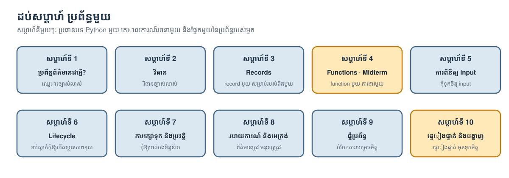

# Programming for Information Systems

**English:** [the same course in English](../README.md)

**Campus FoodBridge · គ្រូបង្រៀន: [Mengsay Loem](https://loem-ms.github.io/) · កំណែភាសាខ្មែរ សម្រាប់អ្នកចាប់ផ្ដើមដំបូង**

## ព្រឹកដែលសៀវភៅក្រដាសបរាជ័យ

ម៉ោង 8:10 នៅព្រឹកដ៏មមាញឹកមួយ នៅ Campus FoodBridge ដែលជាក្រុមអ្នកស្ម័គ្រចិត្តរបស់សាកលវិទ្យាល័យមួយ ប្រមូលអាហារដែលនៅសល់ ហើយយកទៅប្រគល់ឱ្យអង្គការដៃគូក្នុងសហគមន៍។ ទូរស័ព្ទរោទ៍មិនឈប់។ Sunrise Bakery មាន Bread rolls (នំបុ័ង) ដែលត្រូវមកយកក្នុងរយៈពេលពីរម៉ោង អាហារដ្ឋានមួយមានបាយឆ្អិន ហើយតូបនៅផ្សារមួយមានបន្លែ។ ដូចរាល់ដង អ្នកសម្របសម្រួលសរសេរការផ្ដល់ជូន (offer) នីមួយៗ ក្នុងសៀវភៅកំណត់ត្រាក្រដាស។

ដល់ម៉ោង 8:40 ទំព័រសៀវភៅពេញអស់។ លេខទូរស័ព្ទមួយត្រូវបានសរសេរពីរដង សំណើមួយត្រូវបានសរសេរចង្អៀតនៅគែមទំព័រ ហើយក៏បាត់ទៅ ហើយគ្មាននរណាដឹងថា បានសន្យាអ្វីជាមួយដៃគូណានោះទេ។ អាហារមានពិត ហើយដៃគូកំពុងរង់ចាំ ប៉ុន្តែសៀវភៅក្រដាសតាមមិនទាន់ទេ។

វគ្គសិក្សានេះ ជំនួសសៀវភៅក្រដាសនោះ។ ក្នុងមួយសប្ដាហ៍ម្ដង អ្នកបង្កើតផ្នែកមួយនៃប្រព័ន្ធព័ត៌មានតូចមួយ ដែលធ្វើអ្វីដែលសៀវភៅក្រដាសធ្វើមិនបាន។

ពាក្យ programming និងពាក្យបច្ចេកទេស រក្សាជាភាសាអង់គ្លេសដោយចេតនា ព្រោះនៅកម្ពុជា មិនទាន់មានពាក្យបច្ចេកទេសជាភាសាខ្មែរ ដែលគេឯកភាពគ្នានៅឡើយ។

សព្វថ្ងៃ AI អាចសរសេរ code បានច្រើន ហើយវាកាន់តែប្រសើរឡើងរៀងរាល់ឆ្នាំ។ ប៉ុន្តែ AI មិនអាចទទួលខុសត្រូវចំពោះផលប៉ះពាល់ដែលប្រព័ន្ធមួយមានលើមនុស្សបានទេ។ អ្នកដែលសម្រេចចិត្តប្រើ code នោះ ឬអ្នកដែលជ្រើសរើសវិធាន និងវិធីសាស្ត្រ គឺជាអ្នកទទួលខុសត្រូវ។ ក្នុងវគ្គសិក្សានេះ អ្នករៀនមូលដ្ឋាន Python ដើម្បីឱ្យអ្នកអាច **អាន code, សាកល្បងវា និងវាយតម្លៃវា** ព្រោះអ្នកមិនអាចទទួលខុសត្រូវចំពោះ code ដែលអ្នកមិនយល់បានទេ។ រៀងរាល់សប្ដាហ៍ អ្នកបង្កើតផ្នែកមួយនៃប្រព័ន្ធព័ត៌មានតូចមួយ ហើយធ្វើ **ការសម្រេចចិត្តផ្ទាល់ខ្លួនរបស់អ្នក** អំពីផ្នែកនោះ។ ត្រឹមសប្ដាហ៍ទី 10 អ្នកនឹងមានប្រព័ន្ធផ្ទាល់ខ្លួនរបស់អ្នក ដែលដំណើរការបាន ហើយអ្នកអាចពន្យល់ពីការជ្រើសរើសនីមួយៗនៅក្នុងវាបាន។

**មិនត្រូវការចំណេះដឹង programming ពីមុនទេ។**

## ដំណើរនៃវគ្គសិក្សា

**សប្ដាហ៍ទី 4–10 កំពុងធ្វើបច្ចុប្បន្នភាព។** ឯកសារថ្មីនឹងដាក់នៅទីនេះ មុនថ្នាក់រៀននីមួយៗ ដូច្នេះផែនការខាងក្រោមអាចនឹងផ្លាស់ប្ដូរ។

ដប់សប្ដាហ៍នេះ ដើរតាមដំណើររឿងនៃសៀវភៅក្រដាសនោះ។ ក្នុងមួយសប្ដាហ៍ម្ដង អ្នកជំនួសចំណុចខ្សោយមួយរបស់សៀវភៅក្រដាស ដោយផ្នែកមួយនៃប្រព័ន្ធ ហើយផ្នែកនីមួយៗ នាំមកជាមួយគោលការណ៍មួយ។

- **សប្ដាហ៍ទី 1 — [តើប្រព័ន្ធព័ត៌មានជាអ្វី?](notebooks/Week_01.ipynb)** · ឈ្មោះ និងឯកតាច្បាស់លាស់: អ្នកជួបប្រព័ន្ធដែលបានបញ្ចប់រួច ហើយរៀនដាក់ឈ្មោះឱ្យច្បាស់លាស់ ដើម្បីកុំឱ្យមានអ្វីជាការសរសេររញ៉េរញ៉ៃ ដែលមានតែមនុស្សម្នាក់យល់។
- **សប្ដាហ៍ទី 2 — [វិធាន និងការសម្រេចចិត្ត](notebooks/Week_02.ipynb)** · វិធានច្បាស់លាស់: ការសម្រេចចិត្តដែលអ្នកសម្របសម្រួលទុកក្នុងចិត្ត ត្រូវបានសរសេរចុះជាវិធាន ដែលប្រាប់យ៉ាងច្បាស់លាស់ ហើយត្រូវបានសាកល្បង។
- **សប្ដាហ៍ទី 3 — [Records និងទិន្នន័យ](notebooks/Week_03.ipynb)** · record មួយ សម្រាប់របស់ពិតមួយ: សំណើនីមួយៗ មាន record ផ្ទាល់ខ្លួនមួយ ដូច្នេះគ្មានលេខទូរស័ព្ទណាត្រូវបានសរសេរពីរដង ហើយគ្មានសំណើណាបាត់នៅគែមទំព័រទេ។
- **សប្ដាហ៍ទី 4 — Functions ដែលអាចទុកចិត្តបាន · Midterm (កំពុងធ្វើបច្ចុប្បន្នភាព)** · function មួយ ការងារមួយ: ផ្នែកនីមួយៗ ត្រូវបានបង្កើតជា function តូចៗ ដែលអ្នកអាចសាកល្បង និងទុកចិត្តបាន ហើយ Midterm ពិនិត្យប្រព័ន្ធរហូតមកដល់ពេលនេះ។
- **សប្ដាហ៍ទី 5 — ការពិនិត្យ input (កំពុងធ្វើបច្ចុប្បន្នភាព)** · កុំទុកចិត្ត input: សំណើដែលខុស ឬមិនពេញលេញ ត្រូវបានបដិសេធនៅមាត់ទ្វារ ជំនួសឱ្យការចម្លងចូលសៀវភៅ ហើយបង្កបញ្ហានៅពេលក្រោយ។
- **សប្ដាហ៍ទី 6 — Objects និង lifecycle (កំពុងធ្វើបច្ចុប្បន្នភាព)** · ធ្វើឱ្យស្ថានភាពខុស កើតឡើងបានពិបាក: សំណើមួយ អាចផ្លាស់ទីបានតែតាមជំហានដែលសមហេតុផល ដូច្នេះការសន្យាមួយ មិនអាចលោតទៅស្ថានភាពខុសដោយស្ងាត់ៗបានទេ។
- **សប្ដាហ៍ទី 7 — ការរក្សាទុក និងប្រវត្តិ (កំពុងធ្វើបច្ចុប្បន្នភាព)** · កុំឱ្យបាត់បង់ទិន្នន័យ: ថ្ងៃធ្វើការ លែងបាត់ទៅនៅពេលបិទសៀវភៅទៀតហើយ ហើយប្រវត្តិបង្ហាញថា បានសន្យាអ្វីជាមួយនរណា។
- **សប្ដាហ៍ទី 8 — របាយការណ៍ និងអេក្រង់ (កំពុងធ្វើបច្ចុប្បន្នភាព)** · ព័ត៌មានត្រឹមត្រូវ សម្រាប់មនុស្សត្រឹមត្រូវ: អ្នកសម្របសម្រួលឃើញរបាយការណ៍ពេញលេញ រីឯក្ដារព័ត៌មានសាធារណៈ មិនបង្ហាញលេខទូរស័ព្ទឯកជនទេ។
- **សប្ដាហ៍ទី 9 — ការផ្គុំប្រព័ន្ធបញ្ចូលគ្នា (កំពុងធ្វើបច្ចុប្បន្នភាព)** · បំបែកអ្វីដែលប្រែប្រួល ចេញពីអ្វីដែលនៅដដែល: ផ្នែកដែលអ្នកបានបង្កើត ក្លាយជាប្រព័ន្ធតែមួយរបស់អ្នក។
- **សប្ដាហ៍ទី 10 — ផ្ទៀងផ្ទាត់ ប្រគល់ និងបង្ហាញ (កំពុងធ្វើបច្ចុប្បន្នភាព)** · ផ្ទៀងផ្ទាត់ មុននឹងទុកចិត្ត: អ្នកផ្ទៀងផ្ទាត់ប្រព័ន្ធដែលបានបញ្ចប់ ហើយប្រគល់វាទៅឱ្យអ្នកសម្របសម្រួលបន្ទាប់ អាចដំណើរការព្រឹកដ៏មមាញឹកនោះ ដោយគ្មានអ្នក។

## ចាប់ផ្ដើមនៅទីនេះ

1. **រៀបចំតែម្ដង។** អាន [មគ្គុទ្ទេសក៍ការរៀបចំ (setup)](SETUP.md)។ Google Colab ដំណើរការក្នុង browser ដោយមិនចាំបាច់ install អ្វីទេ។
2. **បើកសប្ដាហ៍របស់អ្នក។** ចុច **Open in Colab** ក្នុងតារាងខាងក្រោម បន្ទាប់មក **File → Save a copy in Drive** មុននឹងកែប្រែអ្វីមួយ។
3. **Run setup cell** បន្ទាប់មកធ្វើតាមវគ្គទី 1–3 និងបញ្ជីត្រួតពិនិត្យនៅផ្នែកបញ្ចប់។
4. **រកមើល ⭐ និង ⭐⭐។** ⭐ ជាការងារមូលដ្ឋាន សម្រាប់គ្រប់គ្នា។ ⭐⭐ ជាការងារបន្ថែម (ស្រេចចិត្ត) សម្រាប់ពេលអ្នកចង់ទៅឱ្យឆ្ងាយជាងនេះ។

ទើបមកដល់ថ្មី? សូមអាន [មគ្គុទ្ទេសក៍វគ្គសិក្សា](COURSE_GUIDE.md) មុនសិន: វាពន្យល់អំពីគំនិតរបស់វគ្គសិក្សា ប្រព័ន្ធដែលអ្នកនឹងបង្កើត និងគោលការណ៍រចនាទាំងដប់។

## ឯកសារប្រចាំសប្ដាហ៍

| សប្ដាហ៍ | គោលការណ៍ | អាន | ស្លាយ | Run | ទាញយក |
|---|---|---|---|---|---|
| **1** · តើប្រព័ន្ធព័ត៌មានជាអ្វី? | ឈ្មោះ និងឯកតាច្បាស់លាស់ | [Notebook](notebooks/Week_01.ipynb) | [PDF](/slides/km/Week_01_Slides.pdf) |  | [.ipynb](/downloads/km/Week_01.ipynb) |
| **2** · វិធាន និងការសម្រេចចិត្ត | វិធានច្បាស់លាស់ | [Notebook](notebooks/Week_02.ipynb) | [PDF](/slides/km/Week_02_Slides.pdf) |  | [.ipynb](/downloads/km/Week_02.ipynb) |
| **3** · Records និងទិន្នន័យ | record មួយ សម្រាប់របស់ពិតមួយ | [Notebook](notebooks/Week_03.ipynb) | [PDF](/slides/km/Week_03_Slides.pdf) |  | [.ipynb](/downloads/km/Week_03.ipynb) |
| **4–10** · កំពុងធ្វើបច្ចុប្បន្នភាព | ឯកសារថ្មីនឹងដាក់ មុនថ្នាក់រៀននីមួយៗ | — | — | — | — |

**មុននឹងកែ notebook ក្នុង Colab: ចុចលើពាក្យ Copy to Drive (ឬ ចូលទៅកាន់ File រួចចុច Save a copy in Drive)។** notebook នីមួយៗដកយក (unpack) ប្រព័ន្ធរបស់វគ្គសិក្សាដោយខ្លួនឯង មិនបាច់ upload អ្វីទេ។ [FoodBridge kit ZIP](/downloads/foodbridge_kit.zip) គឺជាប្រព័ន្ធពេញលេញ សម្រាប់ run នៅផ្ទះ (ដាក់ `LANGUAGE = "km"` ក្នុង `my_settings.py` ដើម្បីឃើញអេក្រង់ជាភាសាខ្មែរ)។

## Midterm, final project និងឯកសារយោង

| | ពេលណា | អាន | ស្លាយ | Run |
|---|---|---|---|---|
| **Midterm · រៀបចំផែនការសម្រាប់មួយថ្ងៃ** | សប្ដាហ៍ទី 4 · វគ្គទី 3 | [Notebook](notebooks/Midterm.ipynb) | [PDF](/slides/km/Midterm_Brief.pdf) |  |
| **Python Basics · មើលរហ័ស (ស្រេចចិត្ត)** | សប្ដាហ៍ណាក៏បាន | [Notebook](notebooks/Python_Basics.ipynb) | — |  |
| **ការណែនាំវគ្គសិក្សា** (ថ្នាក់ដំបូង) | សប្ដាហ៍ទី 1 | [មគ្គុទ្ទេសក៍វគ្គសិក្សា](COURSE_GUIDE.md) | [PDF](/slides/km/Orientation.pdf) | — |

## ព័ត៌មានអំពីវគ្គសិក្សា

- [មគ្គុទ្ទេសក៍វគ្គសិក្សា](COURSE_GUIDE.md): ហេតុអ្វីរៀនវគ្គនេះ គោលការណ៍ទាំងដប់ និងរបៀបដែលមួយសប្ដាហ៍ដំណើរការ
- [ការរៀបចំ (Setup)](SETUP.md): Colab ឬកុំព្យូទ័រផ្ទាល់ខ្លួនរបស់អ្នក
- [ការវាយតម្លៃ](ASSESSMENT.md): របៀបដាក់ពិន្ទុ និងវិធានសម្រាប់ប្រើឧបករណ៍ AI
- [កិច្ចការស្រាវជ្រាវ](RESEARCH.md): កិច្ចការស្រាវជ្រាវខ្លីៗទាំងប្រាំមួយ និងពេលដែលត្រូវចែករំលែក
- Final project (កំពុងធ្វើបច្ចុប្បន្នភាព): កម្រិតទាំងបួន ចាប់ពី "run វា" រហូតដល់ "ទំព័រ web"
- [អំពីគ្រូ (English)](../INSTRUCTOR.md) · [Links របស់វគ្គសិក្សា](COURSE_LINKS.md) · [សំណួរ និងជំនួយ (English)](../CONTRIBUTING.md)

*Campus FoodBridge ជាករណីប្រឌិត។ អង្គការ មនុស្ស និងលេខទាំងអស់ក្នុងវគ្គសិក្សានេះ សុទ្ធតែប្រឌិតឡើង។*
